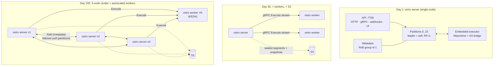

# 03 — Technical Architecture

- [1. Topology & node roles](#1-topology--node-roles)
- [2. Data model: partitions, commands, state machines](#2-data-model-partitions-commands-state-machines)
- [3. Storage layout](#3-storage-layout)
- [4. Replication & cluster metadata](#4-replication--cluster-metadata)
- [5. Execution: dispatcher, executor, workers](#5-execution-dispatcher-executor-workers)
- [6. Unified WIT interface specification](#6-unified-wit-interface-specification)
- [7. The suspend/resume lifecycle](#7-the-suspendresume-lifecycle)
- [8. Placement & spillover](#8-placement--spillover)
- [9. Security & multi-tenancy](#9-security--multi-tenancy)
- [10. Observability](#10-observability)
- [11. Code organisation](#11-code-organisation)

---

## 1. Topology & node roles

### 1.1 One binary, three shapes



### 1.2 Inside a server node

```
┌──────────────────────────────────── ostro server ────────────────────────────────────┐
│  Client listener :7700  (HTTP/1.1 + HTTP/2 + gRPC, TLS)   ─ routes by run-id/partition│
│     │  forwards to partition leader if not local                                      │
│  ┌──▼──────────────────────────────────────────────────────────────────────────────┐  │
│  │ Partition replicas (one per assigned partition)                                 │  │
│  │   journal log (chronik-wal: segments, group commit)                             │  │
│  │   state machine  ── apply(committed entries) ──► redb state store               │  │
│  │   if leader:  dispatcher · ready queues · timer wheel · effect index            │  │
│  └──▲───────────────────────────────▲──────────────────────────────────────────────┘  │
│     │ Activate / Append / Ack       │ follower fetch (replication)                    │
│  ┌──┴──────────────────────┐   ┌────┴────────────────────────────┐                    │
│  │ Embedded executor       │   │ Cluster listener :7701          │                    │
│  │  Wasmtime engine        │   │  Raft (metadata, chronik-raft)  │                    │
│  │  module cache (AOT)     │   │  replication fetch (opt. own    │                    │
│  │  I/O bridge (Tokio)     │   │   address — Chronik RP-10)      │                    │
│  └─────────────────────────┘   └─────────────────────────────────┘                    │
│  Metadata replica (Raft state machine) · blob store (modules) · object-store uploader │
└───────────────────────────────────────────────────────────────────────────────────────┘
```

A **worker** is the "Embedded executor" box alone, connected over the network.

### 1.3 Process model

- **Tokio** multi-thread runtime for network, I/O bridge, replication.
- **Raft driver thread** (one OS thread owns `RawNode`, as in `chronik-raft::driver`).
- **Wasm executor pool**: K threads running Wasmtime fibers (`async_support`), epoch ticker on Tokio.
- **Partition apply**: one task per partition replica; state store writes are batched per apply chunk.

---

## 2. Data model: partitions, commands, state machines

### 2.1 Partitioning

- A fixed number of partitions **P** (default 16 single-node, 64 cluster), set at creation.
- **Run ids embed their partition**: `run_id = base32(partition:u16 ‖ uuidv7)`, so any node routes a run-id request without lookup.
- New runs: `partition = hash(workflow, idempotency_key)` if a key is given (so deduplication is a local lookup), else `hash(uuidv7)`.
- Each partition has exactly **one leader** (single writer). All mutations of a run go through its partition's log.

### 2.2 Log commands (partition journal)

Every state change is a command appended to the partition log and applied deterministically by every replica.

| Command | Appended by | Effect on state |
|---|---|---|
| `RunStarted{run, workflow, version, module_sha, input, opts}` | API (via leader) | create run, enqueue ready, dedupe index |
| `EventsAppended{run, attempt, from_seq, events[]}` | executor (via leader) | append journal events; derive timers/effects/waits; update status |
| `TimerFired{run, op}` | leader timer wheel | append `timer_fired` event, enqueue ready |
| `SignalReceived{run, name, payload}` | API | inbox; enqueue ready if run waits on it |
| `CancelRequested{run, mode}` | API | mark cancelling; enqueue ready |
| `RunTerminated{run, outcome}` | executor | completed/failed/cancelled; DLQ entry on failure |
| `RunsExpired{runs[]}` | leader retention task | delete run + events |
| `ScheduleFired{schedule, fire_time}` | leader of the schedule's partition | exactly-once cron start (idempotency key = schedule ‖ fire_time) |

Leases are **soft state** on the leader (not logged). Fencing: `EventsAppended` carries `attempt` and `from_seq`; the leader rejects it unless `attempt == run.current_attempt` and `from_seq == run.next_seq`. A new leader bumps the attempt of every run that was in flight, so zombie executors are fenced after failover.

### 2.3 Journal event kinds (inside `EventsAppended`)

| Kind | Meaning |
|---|---|
| `activation_started` | attempt number, executor id, logical start time |
| `step_completed` / `step_failed` | step result / failure + attempt |
| `effect_scheduled` / `effect_completed` | outbox intent (request redacted, idempotency key) / response |
| `timer_started` / `timer_fired` | durable sleep |
| `signal_consumed` | payload delivered to a `wait-signal` |
| `child_started` / `child_completed` | child workflow lifecycle |
| `wait_resolved` | **ordered** list of op-ids returned by `wait` (determinism anchor for concurrency) |
| `clock_read` / `patch_marker` | logical time observations / versioning markers |
| `run_completed` / `run_failed` | terminal |

### 2.4 Partition state (redb tables)

| Table | Key → Value | Purpose |
|---|---|---|
| `runs` | run_id → `RunMeta{status, workflow, version, module_sha, queue, attempt, next_seq, tenant, timestamps}` | run index |
| `events` | (run_id, seq) → event | per-run journal for replay (log segments can be truncated after snapshot) |
| `payloads` | (run_id, kind) → bytes | input/output; large values offloaded to blob/object store |
| `ready` | (queue, priority, ready_at, run_id) → () | dispatcher queue (rebuilt into memory on leadership) |
| `timers` | (due_at, run_id, op_id) → () | timer wheel source |
| `effects` | (run_id, op_id) → status | in-flight effects (observability; replay re-drives them) |
| `inbox` | (run_id, name, n) → payload | signals not yet consumed |
| `dedupe` | (workflow, idem_key) → run_id | start idempotency |
| `dlq` | (failed_at, run_id) → reason | dead letters |
| `meta` | `applied_offset`, `leader_epoch_history`, format version | recovery |

The state store is derived: deleting it and replaying the log (or restoring a snapshot + log tail) must reproduce it byte-for-byte. A **state-hash check** (rolling hash of applied commands) compared across replicas detects apply divergence.

---

## 3. Storage layout

```
/var/lib/ostro/
├── node.toml                  # node id, cluster id (generated on first start)
├── meta/                      # metadata Raft log + snapshot (chronik-raft RaftLogStore)
│   ├── state                  # HardState + ConfState (tmp+fsync+rename)
│   ├── snapshot
│   └── log/<index>.seg        # [len u32][crc32 u32][entry]
├── partitions/
│   └── p0007/
│       ├── wal/<base_offset>.seg   # chronik-wal segments; leader epoch stamped per batch
│       ├── wal/epochs              # derived leader-epoch history cache
│       └── state.redb              # partition state machine
├── blobs/<sha256[0:2]>/<sha256>    # uploaded components (zstd), large payloads
├── cache/aot/<key>.cwasm           # Wasmtime AOT artefacts (rebuildable; HMAC'd)
└── tmp/
```

**Bottomless (D9):** an uploader task copies sealed WAL segments, periodic `state.redb` snapshots, metadata snapshots and blobs to object storage (S3/GCS/Azure/local backends from `chronik-storage::object_store`). `ostro restore --from s3://…` rebuilds a node: metadata snapshot → per-partition state snapshot → segment tail.

---

## 4. Replication & cluster metadata

The model is Kafka-with-KRaft as implemented in Chronik Stream: **Raft for metadata, follower-pull ISR replication for data logs.** Details on which code is reused: [04](04-chronik-reuse.md).

### 4.1 Metadata (Raft)

A single Raft group (members = server nodes; 1, 3 or 5) driven by `chronik-raft`'s `RaftDriver` with a `StateMachine` implementation:

| Metadata | Contents |
|---|---|
| Membership | nodes, addresses (client, cluster, optional replication), roles, versions |
| Partition map | per partition: replicas, **leader**, **leader epoch**, **ISR** (published by leaders, only the Raft leader writes assignments — Chronik RP-7) |
| Modules | sha256, language, size, manifest, holders |
| Workflows | name/version → module sha, active version, default queue |
| Queues | executor policy, concurrency, rate limits, spillover thresholds |
| Schedules | cron definitions (firing is done by the owning partition) |
| Security | API token hashes + scopes, tenants + quotas, sealed secrets, secret grants, connections, egress policies |

Proposals return the state machine's result (validated at apply), and retrying an `OutcomeUnknown` proposal is safe — semantics inherited from the Chronik driver.

### 4.2 Partition logs (follower-pull ISR)

- **"A follower is a consumer with a replica id"** (Chronik's principle): followers fetch from the leader using the same read path as executors/history readers.
- Leader tracks each follower's log end offset (LEO); **high watermark HW = min(LEO over ISR)**. Commands are *committed* when HW passes them. Single node: ISR = {self}, HW = fsynced LEO — **same code path** (D5).
- Every batch is stamped with the **leader epoch**. A returning replica asks "where did epoch *e* end?" and truncates its divergent tail (Kafka KIP-101/279 semantics, as in `chronik-server::replication::leader_epoch` + `chronik-wal::truncate`).
- **Failover:** metadata leader elects the new partition leader **only from the ISR** recorded in metadata. The new leader: waits until its state store has applied up to its LEO, bumps attempts of in-flight runs, rebuilds ready queue + timer wheel from state, starts dispatching.
- Followers **apply committed entries** to their own `state.redb` (hot standby), so failover does not need a replay from scratch.
- `min_insync_replicas` (default 2 of 3): if the ISR shrinks below it, the partition stops accepting writes (availability traded for durability, explicitly).

### 4.3 Commit semantics exposed to the engine

| Operation | Returns when |
|---|---|
| API `start run` | `RunStarted` committed (HW) |
| Executor `append` before an effect | `effect_scheduled` committed — **only then** may I/O happen |
| Executor `append` after a step/effect | committed before the guest is resumed past it |
| Signal | `SignalReceived` committed |

---

## 5. Execution: dispatcher, executor, workers

### 5.1 Dispatcher (per partition leader)

- In-memory ready queues per (queue, priority) and a hierarchical timer wheel — rebuilt from `ready`/`timers` on leadership. No polling.
- Assigns **activations** to executor slots honouring queue concurrency, tenant quotas, rate limits and placement policy (§8).
- Tracks soft leases: if an executor misses heartbeats for `lease_ttl`, the run is re-dispatched with `attempt + 1`.

### 5.2 Executor (embedded or worker — same crate)

```
Activate{run, attempt, module_sha, journal (or cursor), input}
  → module cache: L2 (InstancePre in memory) → L1 (AOT .cwasm on disk) → fetch blob by sha + compile
  → instantiate (pooling allocator, CoW memory image)
  → workflows.run(name, input)
  → replay: each guest command compared with journal[seq] (kind + command hash)
       match → return recorded result      mismatch → NonDeterminism → DLQ
  → live: new commands batched into Append{run, attempt, from_seq, events}
       effects only after their effect_scheduled is committed
  → stop on completion / failure / long wait (evict) / memory pressure (evict)
```

- **Hot wait** (default ≤ 2 s per queue): keep the instance resident while short effects complete; otherwise **evict** (drop the call future and Store) and let the timer/signal/effect completion re-dispatch the run, which replays.
- **In-flight effect recovery** needs no separate sweeper: a re-dispatched run replays to an `effect_scheduled` without `effect_completed` and re-executes it with the **same idempotency key**.

### 5.3 Worker protocol (gRPC, bidirectional stream per server node)

```
worker → server                                  server → worker
Hello{id, version, wit_versions, labels,         Welcome{node_id, partitions led, limits}
      capacity{slots, memory}}
Credit{n}                                        Activate{run, attempt, module_sha, journal_page, …}
Append{run, attempt, from_seq, events}           AppendAck{run, committed_seq} | Reject{fenced}
ResolveSecret{run, attempt, name}  (mTLS)        SecretValue{…} (only if granted; never cached)
FetchBlob{sha256}                                BlobChunk{…}
Heartbeat{running runs, load}                    Cancel{run}
Done{run, evicted|terminated}
```

Workers learn membership from `Welcome` and open one stream to **every** server node (each leader dispatches its own partitions). Workers are stateless; killing one only costs re-dispatch after `lease_ttl`.

### 5.4 Resource governance

| Limit | Mechanism | On breach |
|---|---|---|
| Memory | `StoreLimits`, pooling slots, node budget with LRU eviction | `memory_exceeded` → DLQ |
| CPU | Fuel per step/run; epoch slices with async yield | `fuel_exhausted` (retry once) / `timeout` |
| Concurrency | per queue, per tenant, per node slots | backpressure / spill to workers |
| Journal size | max events per run (50k), max inline payload (256 KiB → blob) | warn at 80%, then fail with `continue_as_new` hint |
| Children | max per run, max depth 8 | fail the start |

---

## 6. Unified WIT interface specification

Design principles (unchanged from pgflow): the guest asks, the host decides; non-blocking op handles plus one deterministic `wait`; suspension is invisible to the guest; steps are a guest construct with host bookkeeping; a forward path to WASI 0.3 native async.

```wit
package ostro:runtime@0.1.0;

interface types {
    record payload { content-type: string, data: list<u8> }
    type op-id = u64;
    record datetime { seconds: u64, nanoseconds: u32 }
    record error-info { kind: string, message: string, details: option<payload> }

    variant failure {
        retryable(error-info),
        fatal(error-info),
        timeout,
        cancelled,
    }

    record retry-policy {
        max-attempts: u32,
        initial-interval-ms: u64,
        max-interval-ms: u64,
        backoff-coefficient: f64,
        non-retryable-kinds: list<string>,
    }

    record step-options {
        retry: option<retry-policy>,
        timeout-ms: option<u64>,
        fuel: option<u64>,
    }

    record run-info {
        run-id: string,
        workflow: string,
        workflow-version: u32,
        attempt: u32,
        module-hash: string,
        tenant: option<string>,
        parent-run-id: option<string>,
    }
}

/// Deterministic ambient context (journaled or derived from journaled data).
interface context {
    use types.{run-info, datetime};
    info: func() -> run-info;
    now: func() -> datetime;
    random-u64: func() -> u64;
    random-bytes: func(len: u32) -> list<u8>;
    uuid-v7: func() -> string;
    /// For SDK log suppression only; workflow logic must not branch on it.
    is-replaying: func() -> bool;
    patched: func(change-id: string) -> bool;
}

/// Step bookkeeping for guest-side computation.
interface journal {
    use types.{payload, step-options, failure};

    variant completion-ack {
        recorded,
        /// Short-backoff retryable failure: run the body again now.
        /// (Long backoffs suspend the run; the call never returns in this activation.)
        retry-now,
    }

    resource step {
        seq: func() -> u64;
        complete: func(outcome: result<payload, failure>) -> completion-ack;
    }

    variant step-start {
        replayed(result<payload, failure>),
        execute(step),
    }

    begin-step: func(name: string, opts: step-options) -> step-start;
}

/// Durable side effects executed by the host I/O bridge.
interface effects {
    use types.{payload, op-id, datetime, failure, retry-policy};

    record header {
        name: string,
        /// May contain {{secret:<name>}}; resolved by the host, never visible to the guest.
        value: string,
    }

    record http-request {
        method: string,
        url: string,
        headers: list<header>,
        body: option<list<u8>>,
        timeout-ms: option<u64>,
        idempotency-key: option<string>,
        retry: option<retry-policy>,
        /// JSON pointers in the response body to journal as hashes.
        redact: list<string>,
    }

    record http-response { status: u16, headers: list<header>, body: list<u8> }

    variant sql-value {
        null,
        boolean(bool),
        int8(s64),
        float8(f64),
        numeric(string),
        text(string),
        bytea(list<u8>),
        json(string),
        timestamptz(datetime),
    }

    record sql-request {
        /// Name of a connection registered in Ostro (DSN + secret refs live server-side).
        connection: string,
        statement: string,
        params: list<sql-value>,
        /// Wrap in a transaction with an ostro_effects idempotency token (exactly-once).
        exactly-once: bool,
    }

    record sql-result {
        columns: list<string>,
        rows: list<list<sql-value>>,
        rows-affected: u64,
    }

    record object-request {
        connection: string,
        op: string,          // "get" | "put" | "presign-get" | "presign-put"
        key: string,
        body: option<list<u8>>,
    }

    record child-options {
        queue: option<string>,
        version: option<u32>,
        detached: bool,
    }

    variant op-output {
        http(http-response),
        sql(sql-result),
        object(list<u8>),
        timer,
        signal(payload),
        child(payload),
    }

    record completion { op: op-id, outcome: result<op-output, failure> }

    enum wait-mode { all, any }

    http-fetch: func(req: http-request) -> op-id;
    sql-query: func(req: sql-request) -> op-id;
    object-store: func(req: object-request) -> op-id;
    sleep: func(duration-ms: u64) -> op-id;
    sleep-until: func(at: datetime) -> op-id;
    wait-signal: func(name: string, timeout-ms: option<u64>) -> op-id;
    start-child: func(workflow: string, input: payload, opts: child-options) -> op-id;
    cancel-op: func(op: op-id);

    /// Completions are returned in journaled order — identical on every replay.
    wait: func(ops: list<op-id>, mode: wait-mode) -> list<completion>;
}

interface log {
    enum level { trace, debug, info, warn, error }
    emit: func(level: level, message: string, fields: list<tuple<string, string>>);
}

interface workflows {
    use types.{payload, failure};
    record workflow-meta { name: string, version: u32, default-queue: option<string> }
    describe: func() -> list<workflow-meta>;
    run: func(name: string, input: payload) -> result<payload, failure>;
}

world workflow {
    import context;
    import journal;
    import effects;
    import log;
    export workflows;
}

// The host also satisfies the WASI 0.2 imports pulled in by language runtimes,
// with deterministic, capability-free implementations:
//   wasi:clocks/*  -> journaled logical time      wasi:random/* -> seeded ChaCha20
//   wasi:cli/env   -> empty / manifest vars       stdout/stderr -> log
//   wasi:filesystem -> none or read-only in-memory
//   wasi:sockets, wasi:http -> not provided (deploy-time validation rejects them)
```

**SDK mapping:** Rust (`wit_bindgen::generate!`, mini executor, `join!`), Python (componentize-py bindings, custom `asyncio` loop, `gather`), TS (`jco` types, job loop, `Promise.all`). **Delivery rule:** SDK loops resolve `wait` completions one at a time in the given order and drain the language's ready/microtask queue between them.

**Forward path (`ostro:runtime@0.2.0`, WASI 0.3):** effects become `async func … -> result<…>`; the host still journals completion order.

---

## 7. The suspend/resume lifecycle

### 7.1 Scenario (Python; TS identical apart from the guest loop)

```python
@workflow(name="enrich-lead", version=3)
async def enrich_lead(lead: dict) -> dict:
    profile = await http.get(f"https://api.enrich.example/v2/people?email={lead['email']}",
                             headers={"Authorization": "Bearer {{secret:enrich}}"})
    await ctx.sql("crm", "UPDATE leads SET profile=$1 WHERE id=$2",
                  [profile.json(), lead["id"]], exactly_once=True)
    await ctx.sleep(hours=24)
    return {"ok": True}
```

### 7.2 Sequence

```mermaid
sequenceDiagram
  autonumber
  participant C as Client / webhook
  participant L as Partition leader (log + state + dispatcher)
  participant F as Followers (cluster only)
  participant E as Executor (embedded or worker)
  participant G as Guest (CPython in Wasm)
  participant B as I/O bridge (Tokio)
  participant X as External API / CRM DB

  C->>L: POST /v1/workflows/enrich-lead/runs
  L->>L: append RunStarted (group commit, fsync)
  L-->>F: followers fetch; HW advances
  L-->>C: 202 {run_id}  (after commit)
  L->>E: Activate{run, attempt=1, journal=[]}
  E->>E: InstancePre hit → instantiate (pooling, CoW)
  E->>G: workflows.run("enrich-lead", input)
  G->>E: effects.http-fetch(req) → op0 ; effects.wait([op0])
  E->>L: Append{attempt 1, seq0 activation_started, seq1 effect_scheduled(op0, idem key)}
  L-->>E: AppendAck(committed seq1)
  E->>B: perform op0 (fiber parked; thread serves other runs)
  B->>L: ResolveSecret("enrich") — local call, or mTLS from a worker
  B->>X: GET … Authorization + Idempotency-Key
  X-->>B: 200 {profile}
  E->>L: Append{seq2 effect_completed(op0), seq3 wait_resolved[op0]}
  L-->>E: AppendAck
  E->>G: wait returns — fiber resumes
  G->>E: sql-query(crm, exactly_once) → op1 ; wait([op1])
  E->>L: Append{seq4 effect_scheduled(op1, key)} → Ack
  B->>X: BEGIN; INSERT ostro_effects(key); UPDATE leads…; COMMIT
  E->>L: Append{seq5 effect_completed(op1), seq6 wait_resolved[op1]} → Ack
  G->>E: sleep(24h) → op2 ; wait([op2])
  E->>L: Append{seq7 timer_started(op2, due)} → Ack
  E->>E: due > hot-wait → EVICT (drop future + Store)
  E->>L: Done{run, evicted}
  Note over L: timer wheel holds (due, run, op2). No Wasm memory held.
  L->>L: 24h later: append TimerFired(op2) → run ready
  L->>E: Activate{run, attempt=2, journal seq0..8}
  E->>G: instantiate + run — REPLAY
  G->>E: http-fetch / wait → seq1–3 recorded, no I/O
  G->>E: sql-query / wait → seq4–6 recorded, no SQL
  G->>E: sleep / wait → seq7–8 recorded (timer_fired)
  G-->>E: return {"ok": true}
  E->>L: Append{seq9 activation_started(2)…, run_completed} → RunTerminated
```

### 7.3 Crash analysis

| Crash point | Outcome |
|---|---|
| Before `RunStarted` commits | Client gets an error/timeout; retry with `idempotency_key` deduplicates |
| Executor dies after `effect_scheduled` (seq1), before/while calling the API | Lease expires → re-dispatch (attempt 2) → replay reaches seq1 with no completion → re-send with the **same key** → provider deduplicates |
| Executor dies after the API responded, before `effect_completed` | Same as above; idempotent provider returns the original response |
| SQL effect: crash after the CRM commit, before `effect_completed` | Retry hits `ostro_effects` primary key → connector returns stored result → exactly-once |
| Partition leader dies (cluster) | Metadata elects a leader from the ISR; nothing below HW is lost; the in-flight attempt is fenced (attempt bump); run re-dispatched |
| Single node dies | Restart: state store + log tail; in-flight runs re-dispatched with attempt + 1 |
| Guest traps / exceeds memory | Attempt fails; retry per policy or DLQ; node unaffected |

### 7.4 Versioning

Runs are pinned to `module_sha`; new runs use the active version; modules are retained while referenced. `ctx.patched()` for in-flight evolution. `ostro replay --sample N --module new.wasm` replays recent histories (pulled via the API) locally as a CI gate. `ostro migrate-runs` re-pins runs only after an automatic dry-run replay passes. The host links `ostro:runtime@0.1.x` and `0.2.x` side by side.

---

## 8. Placement & spillover

Unlike the pgflow design (pull-based work stealing from a shared table), the partition leader **is** the dispatcher, so placement is a local decision:

| Queue policy | Behaviour |
|---|---|
| `embedded` | Only the server node's executor |
| `workers` | Only connected workers matching the queue's label selector |
| `auto` | Embedded first; spill to workers when any threshold trips (node CPU > 70% for 10 s, executor slots > 90%, resident Wasm memory > 85%, queue lag > 5 s); hysteresis −15% with a 30 s cool-down |

**KEDA:** each node exports `ostro_queue_worker_demand{queue}` (runs ready for workers that no worker slot is taking) on `/metrics` and `GET /v1/queues/{q}/demand`. A `ScaledObject` with the `prometheus` or `metrics-api` scaler scales a worker Deployment, including to zero.

```yaml
apiVersion: keda.sh/v1alpha1
kind: ScaledObject
metadata: { name: ostro-workers-heavy }
spec:
  scaleTargetRef: { name: ostro-worker-heavy }
  minReplicaCount: 0
  maxReplicaCount: 50
  triggers:
    - type: metrics-api
      metadata:
        url: "https://ostro.ostro.svc:7700/v1/queues/heavy/demand"
        valueLocation: "demand"
        targetValue: "20"
```

---

## 9. Security & multi-tenancy

### 9.1 Threat model

| Threat | Control |
|---|---|
| Malicious/buggy guest exhausts node | Fuel, epoch slicing, memory caps, global budgets, eviction |
| Guest exfiltrates secrets | Secrets never enter guest memory; placeholders allowed only in headers / marked body fields, never in URLs; responses redactable |
| Guest attacks internal network (SSRF) | No sockets; HTTP via bridge with per-module egress allow-lists; private/link-local/metadata ranges blocked by default; DNS-rebinding-safe connect |
| Native crash in Wasmtime/host | Affects one node: restart + (cluster) failover; continuous fuzzing (`wasm-smith` components, malformed WIT values); prompt Wasmtime security upgrades |
| Compromised worker | Workers get activations only for queues they are labelled for; secrets resolved per (run, attempt, name) and only if granted; mTLS with per-worker certs; tokens revocable |
| Tampered module | Content-addressed (sha256); optional signature enforcement (minisign/cosign); deploy-time import validation |
| Tampered AOT cache | HMAC per artefact; mismatch → delete + recompile |
| API abuse | Scoped tokens, per-tenant rate limits, audit log |

### 9.2 Multi-tenancy

| Layer | Isolation |
|---|---|
| Code | One Store per run; no shared memory; cross-workflow interaction only via host-mediated child workflows/signals |
| Data | `tenant` on runs/modules/schedules; tenant-scoped tokens can only see their own resources |
| Secrets & connections | Per-tenant namespaces + per-module grants |
| Capacity | Per-tenant concurrency, fuel/s, memory, event-rate quotas; weighted fair dispatch |
| Network | Per-module egress policy |

### 9.3 Transport & at-rest

TLS on the client listener (self-signed in dev, ACME or provided certs in production); mTLS on the cluster listener and worker streams (cluster CA generated at `cluster init`). Secrets sealed with a key from env/file/KMS; data directory encryption delegated to the filesystem/volume.

---

## 10. Observability

| Signal | Implementation |
|---|---|
| Traces | `workflow.run` (linked across activations via the run's `traceparent`) → `activation` → `step` / `effect:http` / `effect:sql` / `timer`; outbound HTTP gets a child `traceparent`; OTLP export; replayed spans not re-emitted |
| Metrics | `ostro_runs_started_total`, `ostro_queue_ready{queue}`, `ostro_queue_lag_seconds`, `ostro_queue_worker_demand`, `ostro_step_duration_seconds`, `ostro_replay_events_total`, `ostro_fuel_consumed_total{module}`, `ostro_instance_memory_bytes`, `ostro_dlq_total{reason}`, `ostro_partition_hw_lag{partition,replica}`, `ostro_isr_size{partition}`, `ostro_raft_*` |
| Logs | Guest `log.emit` → bounded per-run log (ring buffer) + node logs/OTLP |
| UI | Run list/filter, history timeline with replay markers, DLQ triage, modules, queues, cluster/partition health |

---

## 11. Code organisation

```
ostro/
├── wit/                         # ostro:runtime WIT (source of truth)
├── crates/
│   ├── ostro/                   # the binary: clap subcommands dev|server|worker|deploy|run|…
│   ├── ostro-engine/            # replay, journal model, Wasmtime host, module cache, executor
│   ├── ostro-bridge/            # I/O: http, sql, object store, secrets, egress, rate limits
│   ├── ostro-partition/         # partition log + state machine + dispatcher + timer wheel
│   ├── ostro-meta/              # metadata StateMachine (on chronik-raft driver)
│   ├── ostro-api/               # HTTP/gRPC API, webhooks, auth, UI assets
│   ├── ostro-worker-proto/      # Execute stream protobufs
│   └── ostro-cli/               # build pipeline (cargo / componentize-py / componentize-js)
├── shared/ (or git deps on a chronik-core workspace — see 04)
│   ├── chronik-wal              # segments, group commit, truncation, sparse index
│   ├── chronik-raft             # RaftDriver, RaftLogStore, transport (+ vendored raft-rs)
│   ├── chronik-replication      # (extracted) follower fetch, leader epochs, ISR tracking
│   └── chronik-object-store     # (extracted) S3/GCS/Azure/local backends
├── sdks/{rust,python,typescript}/
├── conformance/
│   ├── sdk/                     # language-neutral workflow scenarios
│   └── replication/             # placement, ISR honesty, divergence, failover (Chronik RP-0 style)
└── deploy/                      # container image, Helm chart, KEDA examples
```

Seams that keep "one engine, many shapes" honest:

```rust
/// Implemented by the partition leader (in-process) and by the worker client (gRPC).
#[async_trait::async_trait]
pub trait ActivationSink: Send + Sync {
    async fn append(&self, run: RunId, attempt: u32, from_seq: u32, events: Vec<Event>)
        -> Result<CommittedSeq, AppendError>;          // AppendError::Fenced on stale attempt/seq
    async fn resolve_secret(&self, run: RunId, attempt: u32, name: &str) -> Result<Secret>;
    async fn fetch_blob(&self, sha: &Sha256) -> Result<Bytes>;
    async fn done(&self, run: RunId, outcome: ActivationOutcome);
}

/// Implemented by redb (default) and fjall (alternative).
pub trait StateStore: Send + Sync {
    fn apply_batch(&self, offset: u64, cmds: &[Command]) -> Result<()>;
    fn applied_offset(&self) -> Result<u64>;
    fn snapshot_to(&self, w: &mut dyn std::io::Write) -> Result<()>;
}
```
