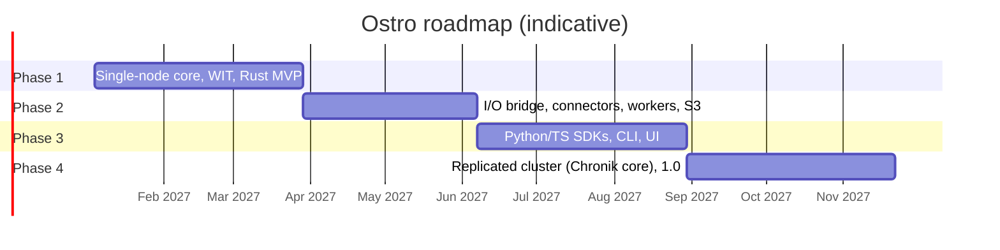

# 05 — Phased Implementation Roadmap

Assumes 3–4 senior Rust engineers (one owning Python/TS SDKs from Phase 3). Durations are planning estimates.

**Cross-cutting from day 1:** CI on linux x86_64/aarch64 + macOS, crash-injection harness (failpoints), SDK conformance skeleton, benchmark dashboard that measures acknowledged work and bytes on disk, not just rates (Chronik RP-11).

**Ordering principle:** ship the single-node product that people can use (Phases 1–3) before the cluster (Phase 4). But build every partition on the replication-ready code path from the start (RF=1, ISR={self}), so Phase 4 adds replicas instead of rewriting.

---

## Phase 0: Spikes (first 2–3 weeks of Phase 1)

| Spike | Question | Pivot if it fails |
|---|---|---|
| S1 | Can `chronik-wal` + `chronik-raft` be consumed as git dependencies with Ostro commands encoded in V2 batches, without dragging in Kafka/server crates? | Start the `chronik-core` extraction immediately (adds ~2 weeks) |
| S2 | componentize-py hello-workflow: deterministic replay with virtualised clocks/random; memory and cold start vs NFR-2 | Python ships with documented limits; prioritise TS |
| S3 | redb apply throughput for batched commands at 10k steps/s on NVMe | Switch `StateStore` to fjall |

---

## Phase 1: Single-node core, WIT contract & Rust MVP (~12 weeks)

**Goal:** `ostro dev` / `ostro server` run Rust workflows with steps, timers and signals. They survive `kill -9` at any point and replay deterministically.

### Deliverables

| Area | Deliverable |
|---|---|
| Binary | `ostro` with `dev`, `server`, `deploy`, `run`, `ls`, `inspect`, `history`, `signal`, `cancel` subcommands; zero-config defaults; TOML config |
| Storage | Partitions (P=16) on `chronik-wal` with group commit; partition state machine on redb; snapshot + log-tail recovery; run ids embed partition |
| Metadata | `ostro-meta` `StateMachine` on `chronik-raft` (single-member group): modules, workflows, queues, tokens |
| Engine | Wasmtime component host (`bindgen!`), virtualised WASI, replay cursor + divergence detection, activation/evict model, fuel/epoch/memory limits, AOT cache + `InstancePre` + pooling |
| Dispatcher | In-memory ready queues + timer wheel per partition, soft leases, attempt fencing, embedded executor via `ActivationSink` |
| WIT | `ostro:runtime@0.1.0`: context, journal, effects (`sleep*`, `wait-signal`, `wait`; HTTP/SQL stubbed), log, workflows |
| API | HTTP/JSON + gRPC: modules, workflows, runs, signals, cancel; token auth (single admin scope) |
| Rust SDK | `#[workflow]`, `#[step]`, `ctx::{now, random, sleep, wait_for_signal}`, `join!` |
| Build | `ostro build` for Rust (cargo → `wasm32-wasip2` → `wasm-opt`, import validation, manifest) |
| Retention | TTL deletion of terminal runs |

### Risks

| Risk | Impact | Mitigation |
|---|---|---|
| State store diverges from log (apply bugs) | High | Deterministic apply, rolling state hash, "delete state and rebuild" test in CI |
| WIT churn breaks SDKs later | Medium | Freeze `0.1` at phase end; additive changes only |
| Chronik crates too coupled | Medium | Spike S1; extraction fallback |

### Exit criteria

- ✅ `order-saga` example (5 steps, timer, signal) runs from `ostro dev` in < 10 minutes on a clean machine.
- ✅ 10,000 random `kill -9` during load → 0 lost accepted runs, every run terminal or correctly resumed.
- ✅ Deleting `state.redb` and restarting rebuilds identical state (hash match).
- ✅ Determinism test guest (`SystemTime::now`, `HashMap` iteration, `rand`) yields identical journals across 1,000 replays; a modified module yields `nondeterminism` at the right `seq`.
- ✅ Infinite-loop, memory-bomb and deep-recursion guests are stopped without affecting other runs.
- ✅ Single node ≥ 5,000 steps/s (Rust, trivial steps, fsync on, 8 vCPU NVMe); start → first step p50 < 5 ms.

---

## Phase 2: I/O bridge, connectors, workers & bottomless (~10 weeks)

**Goal:** workflows safely call the outside world, compute can scale out with workers, and a single node has real disaster recovery.

### Deliverables

| Area | Deliverable |
|---|---|
| Bridge | HTTP effect (hyper + rustls): timeouts, caps, idempotency keys, retries; effect-after-commit rule; replay-driven re-execution of in-flight effects |
| Secrets | Sealed secret store in metadata, `{{secret:…}}` templating, grants, zeroize, redaction; Vault/env/K8s providers |
| Egress | Per-module allow-lists; SSRF guard (private/link-local/metadata blocked; DNS-rebinding-safe) |
| SQL connector | Postgres/MySQL named connections; transactional idempotency token (`ostro_effects`) for exactly-once |
| Workers | `ostro worker --join`: Execute gRPC stream, credits, heartbeats, blob fetch, `ResolveSecret` over mTLS; leases and re-dispatch; queue policies `embedded`/`workers`/`auto` with spillover + hysteresis; label selectors |
| Bottomless | Object-store uploader (extracted `chronik-object-store` backends): sealed segments, state + metadata snapshots, blobs; `ostro backup` / `ostro restore` |
| Ingress | Webhooks with signature verification (Stripe, GitHub, generic HMAC); cron schedules with exactly-once firing |
| Observability v0 | OTel traces (activation/step/effect), Prometheus `/metrics`, `ostro_queue_worker_demand` |

### Risks

| Risk | Impact | Mitigation |
|---|---|---|
| Duplicate side effects with non-idempotent APIs | Medium | Label `at_least_once`; refuse non-idempotent methods without an explicit key when `exactly_once_required` |
| Secret leakage through logs, journal or errors | Critical | Canary-secret scanner over all persisted bytes and log output in CI |
| Worker protocol edge cases (partitions, zombies) | High | Fencing tests: partition the worker mid-effect, resume after lease expiry, assert a single journaled completion |
| Restore correctness | High | Nightly "restore from bucket and compare state hash" job |

### Exit criteria

- ✅ Chaos test vs a mock payment API that honours idempotency keys: 10,000 runs with random executor/worker/node crashes → 0 duplicate charges, 0 lost effects.
- ✅ SQL exactly-once: crash injected between the user DB commit and `effect_completed` → exactly one row change per run.
- ✅ Canary secret never appears on disk, in object storage, logs or OTLP.
- ✅ `auto` queue: load spike moves work to workers, then back to embedded after the cool-down without flapping. Killing a worker re-dispatches within `lease_ttl`.
- ✅ `ostro restore` from S3 on a fresh machine reproduces state (hash match) with RPO ≤ 1 s.
- ✅ Stripe webhook → workflow → signal round trip demo.

---

## Phase 3: Polyglot SDKs, CLI & UI (~12 weeks)

**Goal:** Python and TypeScript are first-class, with identical semantics, one-command build/deploy, and a UI.

### Deliverables

| Area | Deliverable |
|---|---|
| Python SDK | `@workflow`, `@step`, `ctx`, `http`, `sql`; custom asyncio loop; componentize-py + pre-init; stdlib trimming |
| TS SDK | `workflow()`, `step()`, `ctx`; job loop; `jco` types; esbuild → componentize-js + pre-init |
| CLI | `ostro init/build/deploy/replay/dev --watch`; language detection; hermetic toolchain cache; `--docker` builds; `ostro doctor` |
| Conformance | Language-neutral scenarios (steps, retries, timers, signals, concurrency/race, cancellation, children, patching, non-determinism detection); all three SDKs pass |
| Children | Cross-language child workflows with cancellation propagation |
| Test kits | Per-language harness with time-skipping against `ostro dev --ephemeral` |
| UI | Embedded: runs, history timeline (replay markers), DLQ triage + requeue, modules, queues, workers |
| Docs | Getting started per language, determinism guide, connectors, sizing; migrations from cron/queue tables, Temporal and Restate |

### Risks

| Risk | Impact | Mitigation |
|---|---|---|
| Python memory per instance limits concurrency | High | Eviction + replay; per-language default queues; route Python fan-out to workers |
| componentize-py/js churn or missing WIT features | High | Pin versions; avoid exotic WIT (fallback for `resource step` → `u64` handle); compatibility matrix in CI |
| Event-loop determinism subtleties | High | SDK owns the loop; fuzz random gather/race trees and compare journals across replays |
| Toolchain friction | Medium | Hermetic downloads + build container |

### Exit criteria

- ✅ Conformance: 100% for Rust, Python, TS.
- ✅ Instantiate p50: Python < 10 ms, TS < 5 ms, Rust < 1 ms (warm AOT). Resident memory per idle instance published.
- ✅ Usability test with 5 external developers: `init → deploy → run` < 10 min in each language.
- ✅ TS → Python → Rust child chain passes crash injection.
- ✅ `ostro replay` catches deliberate non-deterministic changes in all three languages.

---

## Phase 4: Replicated cluster on Chronik core & production hardening (~12 weeks → 1.0)

**Goal:** 3/5-node HA with no acknowledged-write loss, autoscaled workers, and production operations.

### Deliverables

| Area | Deliverable |
|---|---|
| **Week 1: conformance first** | Port Chronik's RP-0 approach: placement, ISR honesty (measured, not assigned), divergence/truncation, leader failover, `min_insync` enforcement. Tests written to fail before integration |
| Metadata | Multi-member `chronik-raft` group; membership changes; `ostro cluster init/join/remove` |
| Replication | Follower-pull ISR for partition logs (Option A: reuse Chronik's fetcher over the cluster listener); HW; leader epochs + truncation; elect only from ISR; followers apply to state (hot standby); attempt fencing on failover |
| Placement | Partition leader balancing; optional dedicated replication address |
| Single → cluster | `ostro cluster init` promotes an existing single node without export |
| Upgrades | Rolling upgrade across one minor version; version-aware worker claims (WIT compatibility) |
| K8s | Helm chart (StatefulSet for servers, Deployment for workers), KEDA examples, NetworkPolicies |
| Security | mTLS everywhere with cluster CA; scoped tokens; tenants + quotas + fair dispatch; signed modules; external security review |
| Versioning | Module GC, `migrate-runs` with dry-run replay, N/N-1 WIT linkers |
| Perf | Batch appends, replication tail cache, partition-parallel apply |

### Risks

| Risk | Impact | Mitigation |
|---|---|---|
| Replication wired for one path and not another (Chronik's recurring bug class) | Critical | RF=1 already uses the same path since Phase 1; conformance suite gates merge; metrics expose per-partition measured replica counts |
| Kafka-Fetch dependency inside Ostro (Option A) | Medium | Internal only; plan the Option B extraction with Chronik moving onto the shared crate too |
| Failover takes too long (state catch-up) | Medium | Hot-standby apply on followers; measure failover p99 in CI |
| Security review findings late | High | Start review in week 4; fuzzing continuous since Phase 1 |

### Exit criteria (1.0 gate)

- ✅ Replication conformance suite: 100% green, including divergence after a leader dies with unreplicated writes.
- ✅ Jepsen-style run (partitions, clock skew, kill -9, disk stalls) on a 3-node cluster: 0 lost acknowledged runs, 0 duplicate journal entries, fencing holds.
- ✅ Leader failover p99 < 10 s, with runs resuming automatically.
- ✅ 3-node RF=3 ≥ 5,000 steps/s with p99 commit < 20 ms on a LAN, measured as acknowledged and on-disk.
- ✅ KEDA spike demo: workers 0 → N → 0 with no lost or duplicated work.
- ✅ 7-day soak at 70% of rated load: stable memory, no unexplained restarts.
- ✅ Rolling upgrade from the previous minor without draining runs.
- ✅ External security review: no open critical/high findings.

---

## Post-1.0 backlog

- WASI 0.3 native async (`ostro:runtime@0.2.0`).
- Native worker protocol (non-Wasm SDKs in user processes) for native dependencies.
- Polyglot connector components and a registry.
- Chronik/Kafka triggers and journal mirroring for analytics.
- Partition splitting / re-sharding.
- Kubernetes operator (patterned on `chronik-operator`).
- More guest languages (Go via TinyGo/wasip2, C#).

## Top risks

| # | Risk | Phase | Trigger → response |
|---|---|---|---|
| R1 | Replication correctness | 4 (prepared in 1) | Conformance failure → no release; Option A path |
| R2 | Python size/memory | 0, 3 | Miss NFR-2 → document limits, worker-first for Python |
| R3 | Component toolchain churn | 3 | Breaking upstream release → pin + patch upstream |
| R4 | Market crowding (Restate et al.) | all | Measure time-to-first-workflow relentlessly; keep "nothing else to run" uncompromised |
| R5 | Chronik extraction cost | 0, 4 | S1 fails → schedule `chronik-core` extraction before Phase 2 |
