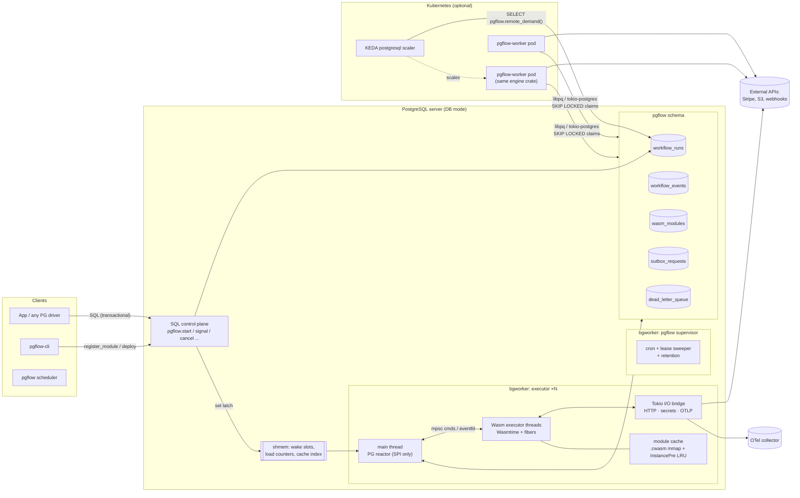

# 03 — Technical Architecture Specification

- [1. System topology](#1-system-topology)
- [2. Unified WIT interface specification](#2-unified-wit-interface-specification)
- [3. Database schema design](#3-database-schema-design)
- [4. Execution engine internals](#4-execution-engine-internals)
- [5. The suspend/resume lifecycle](#5-the-suspendresume-lifecycle)
- [6. Hybrid routing & spillover](#6-hybrid-routing--spillover)
- [7. Security & multi-tenancy](#7-security--multi-tenancy)
- [8. Observability](#8-observability)
- [9. Code organisation](#9-code-organisation)

---

## 1. System topology

### 1.1 Component view



### 1.2 Process/thread view inside one executor bgworker

```
┌──────────────────────────── executor bgworker (OS process) ──────────────────────────────┐
│                                                                                          │
│  [main thread] ── the only thread allowed to call Postgres ───────────────────────────── │
│   loop:                                                                                  │
│     WaitLatch(latch | eventfd | timeout=poll_interval)                                   │
│     CHECK_FOR_INTERRUPTS / SIGTERM / SIGHUP                                              │
│     BEGIN                                                                                │
│       claim ready runs (SKIP LOCKED, batch)        ─┐                                    │
│       apply queued DbCommands (checkpoints,         │ one TX per tick, subtransaction    │
│         outbox inserts, completions) from cmd_rx   ─┘ per run (failure isolation)        │
│     COMMIT  → reply to waiters (oneshot)                                                 │
│                         ▲  DbCommand (mpsc)            │ ClaimedRun / Ack                │
│                         │                              ▼                                 │
│  [wasm executor pool: K threads] ─────────────────────────────────────────────────────── │
│     Wasmtime Engine (shared), Store per run, async fibers                                │
│     epoch ticker → interrupts; fuel per step                                             │
│     host impls of pgflow:runtime/* ; virtualised wasi:*                                  │
│                         ▲                              │ EffectRequest                   │
│                         │ EffectResult                 ▼                                 │
│  [Tokio runtime: M threads] ──────────────────────────────────────────────────────────── │
│     HTTP client (hyper + rustls), secret resolver, egress policy, rate limiter           │
│     OTLP exporter, metrics, epoch ticker task                                            │
└──────────────────────────────────────────────────────────────────────────────────────────┘
```

**Invariants**
1. Only `main` touches Postgres (SPI, memory contexts, `elog`).
2. No transaction is held open while Wasm runs or I/O is in flight.
3. A failure on any non-main thread (trap, panic) turns into a `DbCommand::FailAttempt`. It never propagates into Postgres.
4. Executor threads and Tokio are created **after fork** in `bgworker_main`, never in `_PG_init`.

### 1.3 Remote worker (K8s) view

The `pgflow-worker` binary links the **same** `pgflow-engine` crate. The only difference is the `Backend` implementation (§9): `TokioPostgresBackend` (a connection pool, `LISTEN` for wake-ups, polling as fallback) instead of `SpiBackend`. Workers are stateless. Their only local state is the AOT cache directory, an `emptyDir` warmed by an init container or lazily.

---

## 2. Unified WIT interface specification

### 2.1 Design principles

1. **The guest asks, the host decides.** Every non-deterministic or durable operation is a host call that the host journals, so the guest never needs to know whether it is replaying.
2. **Non-blocking op handles + one deterministic `wait`.** Effects return an `op-id` immediately, and `wait(ops, mode)` blocks until they complete. This is the lowest common denominator that every SDK can map to `async`/`await`, `asyncio.gather` or `Promise.all`. The order in which completions are delivered is **journaled**, so concurrent code replays identically.
3. **Suspension is invisible to the guest.** When a `wait` cannot complete soon (a sleep of 3 days), the host simply **drops the in-flight call and the Store**. The guest never observes it. The next activation replays.
4. **Steps are a guest construct with host bookkeeping.** WIT cannot pass closures, so a step is `begin-step → (replayed | execute(handle)) → handle.complete(result)`.
5. **The forward path to WASI 0.3** keeps the SDK surface stable. The `0.2.0` package of this WIT will express effects as `async func` returning results directly (§2.4).

### 2.2 `pgflow:runtime@0.1.0` (WASI 0.2 compatible)

```wit
package pgflow:runtime@0.1.0;

/// Shared types.
interface types {
    /// Serialised value. Default content-type: "application/json".
    record payload {
        content-type: string,
        data: list<u8>,
    }

    /// Handle to an in-flight durable operation. Allocated deterministically
    /// by the host (monotonic per run), so identical across replays.
    type op-id = u64;

    record datetime {
        seconds: u64,
        nanoseconds: u32,
    }

    record error-info {
        kind: string,
        message: string,
        details: option<payload>,
    }

    variant failure {
        /// Eligible for retry according to the step's retry policy.
        retryable(error-info),
        /// Never retried; propagates to the caller.
        fatal(error-info),
        timeout,
        cancelled,
    }

    record retry-policy {
        max-attempts: u32,
        initial-interval-ms: u64,
        max-interval-ms: u64,
        backoff-coefficient: f64,
        /// error-info.kind values that must not be retried.
        non-retryable-kinds: list<string>,
    }

    record step-options {
        retry: option<retry-policy>,
        timeout-ms: option<u64>,
        /// Deterministic CPU budget for the step body.
        fuel: option<u64>,
    }

    record run-info {
        run-id: string,
        workflow: string,
        workflow-version: u32,
        attempt: u32,
        module-hash: string,
        tenant: option<string>,
        parent-run-id: option<string>,
    }
}

/// Deterministic ambient context. All values are journaled or derived
/// from journaled data, so they replay identically.
interface context {
    use types.{run-info, datetime};

    info: func() -> run-info;

    /// Logical time: recorded when first observed, replayed afterwards.
    now: func() -> datetime;

    /// ChaCha20 stream seeded from the run id.
    random-u64: func() -> u64;
    random-bytes: func(len: u32) -> list<u8>;
    uuid-v7: func() -> string;

    /// True while re-executing journaled history (for SDK-side log suppression only;
    /// workflow logic must NOT branch on this).
    is-replaying: func() -> bool;

    /// Versioning marker: returns true for runs that first reached this point
    /// on code containing `change-id`, false for runs started on older code.
    patched: func(change-id: string) -> bool;
}

/// Step bookkeeping for guest-side computation.
interface journal {
    use types.{payload, step-options, failure};

    resource step {
        /// Journal sequence number of this step (diagnostics).
        seq: func() -> u64;
        /// Report the outcome of the step body.
        complete: func(outcome: result<payload, failure>) -> completion-ack;
    }

    variant completion-ack {
        /// Outcome is durable; continue.
        recorded,
        /// Retryable failure with a short backoff: run the body again now.
        /// (Long backoffs suspend the run; this call then never returns.)
        retry-now,
    }

    variant step-start {
        /// Outcome recorded by a previous activation; do not run the body.
        replayed(result<payload, failure>),
        /// Run the body, then call `step.complete`.
        execute(step),
    }

    begin-step: func(name: string, opts: step-options) -> step-start;
}

/// Durable side effects executed by the host.
interface effects {
    use types.{payload, op-id, datetime, failure, retry-policy};

    // ---------- HTTP ----------
    record header {
        name: string,
        /// May contain `{{secret:<name>}}` placeholders, resolved by the host.
        value: string,
    }

    record http-request {
        method: string,
        url: string,
        headers: list<header>,
        body: option<list<u8>>,
        timeout-ms: option<u64>,
        /// Defaults to a stable key derived from (run-id, op-id).
        idempotency-key: option<string>,
        retry: option<retry-policy>,
        /// JSON pointers in the response body to store hashed, not raw.
        redact: list<string>,
    }

    record http-response {
        status: u16,
        headers: list<header>,
        body: list<u8>,
    }

    // ---------- SQL ----------
    variant sql-value {
        null,
        boolean(bool),
        int8(s64),
        float8(f64),
        numeric(string),
        text(string),
        bytea(list<u8>),
        json(string),
        timestamptz(datetime),
    }

    record sql-request {
        statement: string,
        params: list<sql-value>,
    }

    record sql-result {
        columns: list<string>,
        rows: list<list<sql-value>>,
        rows-affected: u64,
    }

    // ---------- children ----------
    record child-options {
        queue: option<string>,
        version: option<u32>,
        /// Detached children are not awaited and survive parent completion.
        detached: bool,
    }

    // ---------- completion ----------
    variant op-output {
        http(http-response),
        sql(sql-result),
        timer,
        signal(payload),
        child(payload),
    }

    record completion {
        op: op-id,
        outcome: result<op-output, failure>,
    }

    enum wait-mode {
        all,
        any,
    }

    /// Start operations (non-blocking; journaled as *scheduled*).
    http-fetch: func(req: http-request) -> op-id;
    sql-query: func(req: sql-request) -> op-id;
    sleep: func(duration-ms: u64) -> op-id;
    sleep-until: func(at: datetime) -> op-id;
    wait-signal: func(name: string, timeout-ms: option<u64>) -> op-id;
    start-child: func(workflow: string, input: payload, opts: child-options) -> op-id;
    cancel-op: func(op: op-id);

    /// Block until `all` / `any` of `ops` complete. Returns completions in
    /// journaled order: identical on every replay.
    wait: func(ops: list<op-id>, mode: wait-mode) -> list<completion>;
}

/// Structured logging (suppressed during replay by the host).
interface log {
    enum level { trace, debug, info, warn, error }
    emit: func(level: level, message: string, fields: list<tuple<string, string>>);
}

/// What a workflow module exports.
interface workflows {
    use types.{payload, failure};

    record workflow-meta {
        name: string,
        version: u32,
        default-queue: option<string>,
    }

    /// Enumerated at deploy time to populate pgflow.workflows.
    describe: func() -> list<workflow-meta>;

    /// Entry point for one activation (first run or replay).
    run: func(name: string, input: payload) -> result<payload, failure>;
}

world workflow {
    import context;
    import journal;
    import effects;
    import log;
    export workflows;
}

/// Host-side view: pgflow also satisfies the WASI 0.2 imports that language
/// runtimes (CPython, StarlingMonkey, Rust std) pull in, with deterministic,
/// capability-free implementations:
///   wasi:clocks/*          -> logical journaled time
///   wasi:random/*          -> seeded ChaCha20
///   wasi:cli/environment   -> empty (or fixed manifest-declared vars)
///   wasi:cli/stdout|stderr -> routed to `log`
///   wasi:filesystem/*      -> read-only in-memory FS or none
///   wasi:sockets/*, wasi:http/* -> NOT provided (deploy-time validation rejects)
world workflow-host {
    include workflow;
}
```

### 2.3 How each SDK maps onto the contract

| Concept | Rust (`pgflow` crate) | Python (`pgflow` package) | TypeScript (`@pgflow/sdk`) |
|---|---|---|---|
| Bindings | `wit_bindgen::generate!` | `componentize-py bindings` | `jco types` |
| Executor | Tiny single-threaded `Future` executor; each pending future holds an `op-id`; when all are pending → `effects.wait(pending, any)` | Custom `asyncio` event loop (`PgflowLoop`); `Future`s keyed by `op-id`; `run_until_complete` calls `wait` | Custom job loop: promises keyed by `op-id`, resolved from `wait` completions in order; microtasks drained between completions |
| `step` | `#[step]` macro → `begin-step` / `complete` | `@step` decorator | `step(name, opts, fn)` |
| `gather` | `futures::join!` / `join_all` | `asyncio.gather` | `Promise.all` |
| `race/select` | `select!` (biased by op-id order) | `asyncio.wait(FIRST_COMPLETED)` | `Promise.race` |
| Native time/random | Works (WASI virtualised); lint suggests `ctx::now()` | Works (`time.time()`, `random`) | Works (`Date.now()`, `Math.random()`) |
| Serialization | `serde_json` | `json` / `pydantic` optional | `JSON` / zod optional |

**Deterministic delivery rule (all SDKs).** The SDK loop asks for completions only through `wait`, resolves the returned completions **one at a time, in the order given**, and drains the language's microtask/ready queue fully before resolving the next one. The host guarantees the same order on replay, so the interleaving of guest code is identical.

### 2.4 Forward path: `pgflow:runtime@0.2.0` on WASI 0.3 async

Once Component Model async is stable in Wasmtime and supported by componentize-py/js, effects become native async functions. The SDK surface does not change; only the SDK internals do.

```wit
interface effects {
    http-fetch: async func(req: http-request) -> result<http-response, failure>;
    sql-query:  async func(req: sql-request)  -> result<sql-result, failure>;
    sleep:      async func(duration-ms: u64);
    wait-signal: async func(name: string, timeout-ms: option<u64>) -> result<payload, failure>;
}
```

The host still journals completion order. With native async, the component model's task/waitable machinery delivers completions, and the host controls their order.

---

## 3. Database schema design

### 3.1 Principles

- **Hot/cold split.** The claim path touches narrow, fixed-width rows only. Large payloads live in side tables (TOASTed) or an object store.
- **Journal is append-only.** It is never updated, which makes it safe to partition and cheap to replicate.
- **Time-ordered ids.** `uuidv7` for runs gives index locality and allows range partitioning **by id**, so the partition key is part of the primary key with no extra columns.
- **Fencing everywhere.** Mutations from executors carry `lease_owner` + `attempt` predicates.

### 3.2 Core DDL

```sql
CREATE SCHEMA pgflow;

CREATE TYPE pgflow.run_status AS ENUM
  ('pending', 'running', 'suspended', 'completed', 'failed', 'cancelling', 'cancelled');

-- ───────────────────────── modules & definitions ─────────────────────────
CREATE TABLE pgflow.wasm_modules (
  id            uuid PRIMARY KEY DEFAULT pgflow.uuidv7(),
  name          text        NOT NULL,
  sha256        bytea       NOT NULL UNIQUE,     -- identity of the component
  language      text        NOT NULL CHECK (language IN ('rust','python','typescript','other')),
  wit_version   text        NOT NULL,            -- e.g. pgflow:runtime@0.1.0
  sdk_version   text        NOT NULL,
  component     bytea       NOT NULL,            -- zstd-compressed component bytes
  size_bytes    integer     NOT NULL,            -- uncompressed
  manifest      jsonb       NOT NULL,            -- workflows, required secrets, egress, limits
  limits        jsonb       NOT NULL DEFAULT '{}',
  owner_role    name        NOT NULL DEFAULT current_user,  -- role used for SQL effects
  tenant        text,
  signature     bytea,                           -- optional cosign/minisign
  created_at    timestamptz NOT NULL DEFAULT now()
);
-- Already compressed: skip pglz/lz4, store out-of-line.
ALTER TABLE pgflow.wasm_modules ALTER COLUMN component SET STORAGE EXTERNAL;

CREATE TABLE pgflow.queues (
  name             text PRIMARY KEY,
  executor         text NOT NULL DEFAULT 'local' CHECK (executor IN ('local','remote','auto')),
  max_concurrency  integer,
  rate_limit       jsonb,                        -- {"per_second": 50, "burst": 100}
  spillover        jsonb NOT NULL DEFAULT '{}',  -- thresholds, see §6
  durable_commit   boolean NOT NULL DEFAULT true -- false => SET LOCAL synchronous_commit = off
);
INSERT INTO pgflow.queues(name) VALUES ('default');

CREATE TABLE pgflow.workflows (
  name           text    NOT NULL,
  version        integer NOT NULL,
  module_id      uuid    NOT NULL REFERENCES pgflow.wasm_modules(id),
  is_active      boolean NOT NULL DEFAULT false,
  default_queue  text    NOT NULL DEFAULT 'default' REFERENCES pgflow.queues(name),
  retry_policy   jsonb,
  PRIMARY KEY (name, version)
);
CREATE UNIQUE INDEX workflows_one_active ON pgflow.workflows (name) WHERE is_active;

-- ───────────────────────── runs (hot table) ─────────────────────────
CREATE TABLE pgflow.workflow_runs (
  id                uuid        PRIMARY KEY,           -- uuidv7
  workflow          text        NOT NULL,
  workflow_version  integer     NOT NULL,
  module_id         uuid        NOT NULL,              -- pinned at start (D1/versioning)
  queue             text        NOT NULL,
  status            pgflow.run_status NOT NULL DEFAULT 'pending',
  priority          smallint    NOT NULL DEFAULT 0,
  visible_at        timestamptz NOT NULL DEFAULT now(),-- next time it may be claimed
  lease_owner       text,                              -- worker id
  lease_expires_at  timestamptz,
  attempt           integer     NOT NULL DEFAULT 0,    -- activation counter (fencing token)
  next_seq          integer     NOT NULL DEFAULT 0,    -- journal high-water mark
  executor_hint     text,                              -- step-level plane migration
  idempotency_key   text,
  parent_run_id     uuid,
  tenant            text,
  traceparent       text,
  created_at        timestamptz NOT NULL DEFAULT now(),
  updated_at        timestamptz NOT NULL DEFAULT now()
) WITH (fillfactor = 70, autovacuum_vacuum_scale_factor = 0.01,
        autovacuum_vacuum_cost_limit = 2000);

CREATE INDEX runs_claim ON pgflow.workflow_runs (queue, priority DESC, visible_at)
  WHERE status IN ('pending', 'suspended');
CREATE INDEX runs_expired_leases ON pgflow.workflow_runs (lease_expires_at)
  WHERE status = 'running';
CREATE UNIQUE INDEX runs_dedupe ON pgflow.workflow_runs (workflow, idempotency_key)
  WHERE idempotency_key IS NOT NULL;
CREATE INDEX runs_children ON pgflow.workflow_runs (parent_run_id)
  WHERE parent_run_id IS NOT NULL;

-- Cold side table: input/output can be large; updated rarely.
CREATE TABLE pgflow.run_payloads (
  run_id   uuid PRIMARY KEY REFERENCES pgflow.workflow_runs(id) ON DELETE CASCADE,
  input    jsonb NOT NULL,
  output   jsonb,
  error    jsonb
);

-- Terminal runs are moved here by the retention job (keeps the hot table tiny).
CREATE TABLE pgflow.workflow_runs_archive (
  LIKE pgflow.workflow_runs,
  completed_at timestamptz NOT NULL,
  input jsonb, output jsonb, error jsonb,
  PRIMARY KEY (id)
) PARTITION BY RANGE (id);   -- monthly partitions on uuidv7 boundaries

-- ───────────────────────── journal ─────────────────────────
CREATE TABLE pgflow.workflow_events (
  run_id        uuid        NOT NULL,
  seq           integer     NOT NULL,
  kind          text        NOT NULL,  -- see 3.3
  name          text,                  -- step / effect / signal name
  op_id         bigint,
  attempt       integer,
  command_hash  bytea,                 -- hash of the guest command, for divergence detection
  logical_time  timestamptz NOT NULL,  -- value served to ctx.now() at this point
  payload       jsonb,                 -- result / request (secrets redacted)
  payload_ref   text,                  -- object-store key if > inline limit
  fuel_used     bigint,
  created_at    timestamptz NOT NULL DEFAULT now(),
  PRIMARY KEY (run_id, seq)
) PARTITION BY RANGE (run_id);         -- monthly partitions on uuidv7 boundaries

-- ───────────────────────── signals inbox ─────────────────────────
CREATE TABLE pgflow.signals (
  id            bigint GENERATED ALWAYS AS IDENTITY PRIMARY KEY,
  run_id        uuid  NOT NULL,
  name          text  NOT NULL,
  payload       jsonb,
  created_at    timestamptz NOT NULL DEFAULT now(),
  consumed_seq  integer                -- journal seq that consumed it
);
CREATE INDEX signals_pending ON pgflow.signals (run_id, name, id) WHERE consumed_seq IS NULL;

-- ───────────────────────── outbox ─────────────────────────
CREATE TABLE pgflow.outbox_requests (
  id                uuid PRIMARY KEY DEFAULT pgflow.uuidv7(),
  run_id            uuid    NOT NULL,
  op_id             bigint  NOT NULL,
  scheduled_seq     integer NOT NULL,   -- journal seq of 'effect_scheduled'
  kind              text    NOT NULL CHECK (kind IN ('http','grpc','object_store')),
  request           jsonb   NOT NULL,   -- secrets as {{secret:x}} refs, never values
  idempotency_key   text    NOT NULL,
  status            text    NOT NULL DEFAULT 'pending'
                    CHECK (status IN ('pending','in_flight','done','failed')),
  attempts          integer NOT NULL DEFAULT 0,
  next_attempt_at   timestamptz NOT NULL DEFAULT now(),
  lease_owner       text,
  lease_expires_at  timestamptz,
  executor          text NOT NULL DEFAULT 'any',
  response          jsonb,
  error             jsonb,
  created_at        timestamptz NOT NULL DEFAULT now(),
  completed_at      timestamptz,
  UNIQUE (run_id, op_id)
) WITH (fillfactor = 80);
CREATE INDEX outbox_due ON pgflow.outbox_requests (next_attempt_at)
  WHERE status IN ('pending', 'in_flight');

-- ───────────────────────── DLQ ─────────────────────────
CREATE TABLE pgflow.dead_letter_queue (
  id                bigint GENERATED ALWAYS AS IDENTITY PRIMARY KEY,
  run_id            uuid  NOT NULL,
  workflow          text  NOT NULL,
  workflow_version  integer NOT NULL,
  reason            text  NOT NULL CHECK (reason IN
                    ('retries_exhausted','nondeterminism','trap','fuel_exhausted',
                     'memory_exceeded','module_missing','wit_incompatible','cancelled_by_policy')),
  error             jsonb NOT NULL,
  last_seq          integer,
  dead_at           timestamptz NOT NULL DEFAULT now(),
  requeued_at       timestamptz
);
CREATE INDEX dlq_open ON pgflow.dead_letter_queue (workflow, dead_at) WHERE requeued_at IS NULL;

-- ───────────────────────── supporting ─────────────────────────
CREATE TABLE pgflow.schedules (
  name text PRIMARY KEY, cron text NOT NULL, timezone text NOT NULL DEFAULT 'UTC',
  workflow text NOT NULL, input jsonb NOT NULL DEFAULT '{}', opts jsonb NOT NULL DEFAULT '{}',
  next_fire_at timestamptz NOT NULL, enabled boolean NOT NULL DEFAULT true
);
CREATE TABLE pgflow.workers (
  id text PRIMARY KEY, plane text NOT NULL CHECK (plane IN ('local','remote')),
  host text, version text, started_at timestamptz, heartbeat_at timestamptz, load jsonb
);
CREATE TABLE pgflow.secret_grants (
  module_name text NOT NULL, secret_name text NOT NULL, PRIMARY KEY (module_name, secret_name)
);
CREATE TABLE pgflow.audit_log (
  id bigint GENERATED ALWAYS AS IDENTITY PRIMARY KEY, at timestamptz NOT NULL DEFAULT now(),
  actor name NOT NULL DEFAULT session_user, action text NOT NULL, target text, details jsonb
);
```

### 3.3 Journal event kinds

| kind | Written when | Payload |
|---|---|---|
| `run_started` | first activation | input digest, module sha, seed |
| `step_started` | `begin-step` → `execute` (only if step has timeout/retries) | options |
| `step_completed` / `step_failed` | `step.complete` | result / failure, attempt |
| `effect_scheduled` | `http-fetch`, `sql-query` (http only; sql completes in same TX) | request (redacted) |
| `effect_completed` | outbox done, or sql executed | response |
| `timer_started` / `timer_fired` | `sleep*` / due | fire time |
| `signal_received` | `wait` consumed a signal | payload |
| `child_started` / `child_completed` | child lifecycle | child run id / result |
| `wait_resolved` | `wait` returned | **ordered list of op-ids**: the determinism anchor for concurrency |
| `patch_marker` | first `patched(id)` call | change-id, value |
| `run_completed` / `run_failed` / `run_cancelled` | terminal | output digest / error |

### 3.4 Partitioning, retention & vacuum strategy

| Table | Strategy |
|---|---|
| `workflow_runs` | **Not partitioned.** It is kept small by moving terminal runs to `workflow_runs_archive` in batches (`WITH moved AS (DELETE … RETURNING *) INSERT …`). Aggressive autovacuum, `fillfactor=70` for HOT updates (indexed columns change rarely except `status`/`visible_at`). Schedule `REINDEX CONCURRENTLY runs_claim` if bloat > 30%. |
| `workflow_events` | Range-partitioned by `run_id` (uuidv7 → monthly boundaries; helper `pgflow.uuidv7_floor(ts)`). Partitions created ahead by the supervisor. **Retention** drops a partition once its age > TTL **and** no non-terminal run has an id in its range. Long-lived workflows should use `continue_as_new`, which starts a fresh run id and releases old partitions. |
| `workflow_runs_archive` | Range-partitioned by `id` monthly, dropped by TTL. |
| `outbox_requests` | Done rows deleted after the response is journaled + grace period. Small steady state. |
| `signals` | Consumed rows deleted with the run's archival. |

**Why not `pg_partman`?** A dependency is not allowed in plain-SQL mode on managed PG. The supervisor (DB mode) or the worker's maintenance task (remote mode) runs the same ~100 lines of PL/pgSQL maintenance, guarded by an advisory lock.

### 3.5 Key SQL API implementations (sketch)

```sql
CREATE FUNCTION pgflow.start(p_workflow text, p_input jsonb, p_opts jsonb DEFAULT '{}')
RETURNS uuid LANGUAGE plpgsql SECURITY DEFINER SET search_path = pgflow, pg_temp AS $$
DECLARE v_id uuid := pgflow.uuidv7(); v_wf pgflow.workflows;
BEGIN
  SELECT * INTO v_wf FROM pgflow.workflows
   WHERE name = p_workflow
     AND (CASE WHEN p_opts ? 'version' THEN version = (p_opts->>'version')::int ELSE is_active END);
  IF NOT FOUND THEN RAISE EXCEPTION 'pgflow: no active workflow %', p_workflow; END IF;

  INSERT INTO pgflow.workflow_runs (id, workflow, workflow_version, module_id, queue, priority,
         visible_at, idempotency_key, parent_run_id, tenant, traceparent)
  VALUES (v_id, v_wf.name, v_wf.version, v_wf.module_id,
          coalesce(p_opts->>'queue', v_wf.default_queue),
          coalesce((p_opts->>'priority')::smallint, 0),
          now() + coalesce((p_opts->>'delay')::interval, '0'),
          p_opts->>'idempotency_key', (p_opts->>'parent_run_id')::uuid,
          p_opts->>'tenant', p_opts->>'traceparent')
  ON CONFLICT (workflow, idempotency_key) WHERE idempotency_key IS NOT NULL DO NOTHING;

  IF NOT FOUND THEN  -- deduplicated: return existing run id
    SELECT id INTO v_id FROM pgflow.workflow_runs
     WHERE workflow = p_workflow AND idempotency_key = p_opts->>'idempotency_key';
    RETURN v_id;
  END IF;

  INSERT INTO pgflow.run_payloads(run_id, input) VALUES (v_id, p_input);
  PERFORM pgflow._wake(coalesce(p_opts->>'queue', v_wf.default_queue)); -- DB mode: latch via shmem
  RETURN v_id;                                                       -- SQL mode: debounced NOTIFY
END $$;
```

`pgflow._wake` is a C/Rust function in DB mode that sets the latch through shmem **at commit** (registered with `RegisterXactCallback`, so a rolled-back start never wakes anyone). In plain-SQL mode it is a PL/pgSQL stub that issues `NOTIFY` only if `pg_notification_queue_usage()` is low and no notify was sent in this transaction.

---

## 4. Execution engine internals

### 4.1 Module cache (three levels)

| Level | Where | Key | Content | Shared across |
|---|---|---|---|---|
| L0 | `pgflow.wasm_modules.component` | `sha256` | zstd component bytes (source of truth) | everything |
| L1 | Local disk: `pgflow.cache_dir` (GUC; default outside `PGDATA` when writable, else `$PGDATA/pgflow_cache`, which is **rebuildable and safe to exclude from backups**) | `(sha256, wasmtime_version, target_triple, cpu_features_hash, engine_config_hash)` | AOT `.cwasm` + HMAC | all processes on the host: `mmap`ed read-only, so code pages are shared through the OS page cache |
| L2 | Per-process LRU | `sha256` | `Component` + `InstancePre` (imports pre-linked) + pooling slot | one executor process |

- **Deploy-time compilation:** `pgflow.register_module()` enqueues a `compile` task; an executor compiles on a background thread and writes L1. The first run can then pay only the deserialize cost. Remote workers compile lazily or in an init container.
- **Integrity:** `.cwasm` files are written atomically (tmp + rename) with an HMAC keyed by a per-cluster secret. A mismatch triggers deletion and recompilation. This matters because `Component::deserialize_file` is `unsafe` on untrusted input.

### 4.2 Activation model

An **activation** = instantiate → `workflows.run(name, input)` → replay prefix from the journal → execute new commands → stop when the run (a) completes, (b) fails, or (c) blocks on ops that will not complete soon.

```
                        ┌─────────────── hot wait ───────────────┐
 claim ──► instantiate ─► replay ─► execute ─► wait(ops) ──► ops done ≤ hot_wait_ms? ─yes─► continue
                                                    │
                                                    └─ no / memory pressure ─► EVICT:
                                                         drop call future + Store,
                                                         status='suspended', visible_at=next due,
                                                         release lease
```

- **Hot wait** (default ≤ 2 s, configurable per queue): the instance stays resident while short HTTP calls complete, so replay is avoided for the common case.
- **Evict** on long timers, signals, child waits or memory pressure (LRU over resident instances against `pgflow.max_resident_memory`). The cost is replaying on wake, which is cheap because recorded results are returned without re-executing effects.
- Dropping a Wasmtime async call future mid-flight is safe; the whole Store is discarded, and no guest destructor needs to run.

### 4.3 Replay & divergence detection

1. The host keeps a per-activation **command cursor** `seq`, starting at 0.
2. Each guest command (`begin-step`, `http-fetch`, `sleep`, `wait`, `now`, `patched`...) computes `command_hash = H(kind, name, canonical(request minus secret values))`.
3. If `seq < next_seq` (replaying): load event `seq` and **compare** `kind` + `command_hash`.
   - Match → return the recorded result. No I/O, no journaling.
   - Mismatch → `NonDeterminismError{seq, expected, actual}` → the attempt fails and the run moves to the DLQ with reason `nondeterminism` (never auto-retried, because retrying cannot fix it).
4. If `seq ≥ next_seq`: execute live, append events, `next_seq += n`.
5. Journal events are prefetched in one query per activation (paged for long histories).

### 4.4 Resource governance per activation

| Limit | Mechanism | On breach |
|---|---|---|
| Memory | `StoreLimits` (max memory size, tables, instances), pooling slot size | Trap → `memory_exceeded` → DLQ (not retryable by default) |
| CPU (deterministic) | Fuel per step/run (`Store::set_fuel`) | `fuel_exhausted` → retryable once, then DLQ |
| CPU (wall clock) | Epoch deadline per activation slice; yields cooperatively (`epoch_deadline_async_yield_and_update`) so one guest cannot monopolise a thread | Long-running guests are time-sliced; past the hard deadline → `timeout` |
| Concurrency | Global semaphore (instances), per-queue `max_concurrency`, per-tenant quota | Claim fewer runs |
| Journal growth | Max events per run (default 50k), max payload inline size (default 256 KiB) | Warn at 80%; fail with a `continue_as_new` hint |

---

## 5. The suspend/resume lifecycle

### 5.1 Scenario

A **Python** workflow (identical for TypeScript; only the guest event loop differs):

```python
@workflow(name="enrich-lead", version=3)
async def enrich_lead(lead: dict) -> dict:
    profile = await http.get(f"https://api.clearbit.example/v2/people?email={lead['email']}",
                             headers={"Authorization": "Bearer {{secret:clearbit}}"})
    await ctx.sql("UPDATE leads SET profile=$1 WHERE id=$2", [profile.json(), lead["id"]])
    await ctx.sleep(hours=24)
    return {"ok": True}
```

### 5.2 Sequence diagram

```mermaid
sequenceDiagram
  autonumber
  participant App
  participant PG as Postgres (tables)
  participant Main as Executor main thread (SPI)
  participant W as Wasm thread (Wasmtime fiber)
  participant G as Guest (CPython in Wasm)
  participant T as Tokio I/O bridge
  participant API as clearbit API

  App->>PG: BEGIN; INSERT lead; SELECT pgflow.start('enrich-lead', ...); COMMIT
  PG-->>Main: xact callback sets latch (shmem wake slot)
  Main->>PG: TX: claim (SKIP LOCKED) → status=running, attempt=1, lease
  Main->>W: ClaimedRun{run, module sha, journal=[]}
  W->>W: L2 cache hit → InstancePre.instantiate_async (pooling, CoW)
  W->>G: workflows.run("enrich-lead", input)
  G->>W: effects.http-fetch(req{headers: "{{secret:clearbit}}"}) → op 0
  W->>Main: DbCommand::ScheduleEffect(seq0 effect_scheduled, outbox row, idem key)
  Main->>PG: TX: INSERT event seq0 + outbox_requests (fenced by lease/attempt)
  Main-->>W: ack (committed)
  W->>T: EffectRequest(op 0)
  G->>W: effects.wait([op0], all)  — fiber suspends (async host fn)
  T->>T: resolve secret, egress check, add Idempotency-Key
  T->>API: GET /v2/people (HTTP/2, rustls)
  API-->>T: 200 {profile}
  T->>W: EffectResult(op 0, response)
  W->>Main: DbCommand::CompleteEffect(seq1 effect_completed, seq2 wait_resolved[0])
  Main->>PG: TX: INSERT events seq1..2; UPDATE outbox done
  Main-->>W: ack
  W->>G: wait returns [completion op0] — fiber resumes
  G->>W: effects.sql-query(UPDATE leads ...) → op 1
  W->>Main: DbCommand::SqlEffect(op1)
  Main->>PG: TX: SET LOCAL ROLE module_owner; UPDATE leads; INSERT events seq3 (scheduled+completed) — atomic
  Main-->>W: result rows_affected=1
  G->>W: wait([op1]) → immediate (already complete), journal seq4 wait_resolved
  G->>W: effects.sleep(86_400_000) → op 2;  wait([op2])
  W->>W: due in 24h > hot_wait → EVICT: drop future + Store
  W->>Main: DbCommand::Suspend(seq5 timer_started, visible_at=now+24h)
  Main->>PG: TX: INSERT event; status=suspended, visible_at, lease=NULL
  Note over PG: 24 hours pass. No memory held.
  Main->>PG: TX: claim (visible_at ≤ now) → attempt=2
  Main->>W: ClaimedRun{journal seq0..5}
  W->>G: instantiate + workflows.run(...) — REPLAY
  G->>W: http-fetch → seq0 matches hash → op0 (no I/O)
  G->>W: wait([op0]) → seq1/2 recorded → returns profile instantly
  G->>W: sql-query → seq3 recorded → no SQL executed
  G->>W: sleep → seq5 recorded; timer due → journal timer_fired (seq6)
  G-->>W: return {"ok": true}
  W->>Main: DbCommand::Complete(seq7 run_completed, output)
  Main->>PG: TX: INSERT event; status=completed; run_payloads.output
```

### 5.3 Step-by-step commentary

| # | What happens | Durability point | Crash here ⇒ |
|---|---|---|---|
| 1–2 | `start()` commits with the app's transaction. The xact callback wakes an executor. | Run row committed | Nothing lost. The sweeper or poll picks it up. |
| 3 | Claim sets `running`, increments `attempt` (fencing token), sets a lease. | Lease committed | Lease expires → re-claimed with `attempt=2`. |
| 5 | Instantiation from `InstancePre`: CPython heap pre-initialised at build time (componentize-py), so there is **no interpreter boot**. | — | — |
| 7–10 | `http-fetch` journals `effect_scheduled` **and** the outbox row in one TX *before* any network I/O. | Intent durable | Replay finds seq0 and re-attaches to the existing outbox row. No duplicate request beyond the idempotency-key retry. |
| 12 | Guest `await` → SDK loop → `wait()` → async host fn. The **fiber parks**; the Wasm thread serves other runs. | — | — |
| 13–15 | Tokio resolves the secret (never in guest memory), checks egress, sets `Idempotency-Key`, sends. | — | Crash mid-flight: the outbox lease expires; the sweeper resends with the **same key**. |
| 17–19 | Response + `wait_resolved` order journaled, then the guest resumes. | Result durable | Replay returns the recorded response. |
| 22–24 | SQL effect: business UPDATE and journal insert commit **atomically**. | Exactly-once | Either both or neither. |
| 26–28 | Long sleep → evict. The Store is dropped and the run goes to `suspended` with `visible_at`. | Timer durable | — |
| 30–36 | Reactivation replays from the journal (sub-millisecond for this history). | — | Same as first activation. |
| 37–38 | Completion. Children/parents are notified through their own journals and wake-ups. | Terminal | — |

### 5.4 Versioning & deterministic replay across deploys

1. **Pinning:** every run stores `module_id`. Reactivations always load *that* module, even after a new version is activated, and old modules are retained while any non-terminal run references them (FK-style check in `pgflow.gc_modules()`).
2. **New runs** use the active version.
3. **Hot-fixing in-flight runs** (opt-in): `pgflow.migrate_runs(workflow, from_version, to_version)` re-pins runs. This is safe only if the new code is replay-compatible, so it is **gated** by automatic replay verification: the migration replays each run's history against the new module in a dry-run sandbox and refuses on any divergence.
4. **Patch markers:** `if ctx.patched("send-sms-v2"): ...`, Temporal-style. The first evaluation journals the value; replays reuse it.
5. **CI gate:** `pgflow replay --from-db --sample 1000 --module ./build/new.wasm` downloads recent histories and replays them locally.
6. **WIT compatibility:** the host serves `pgflow:runtime@0.1.x` and `0.2.x` simultaneously through separate `Linker`s, selected by the component's declared imports.

---

## 6. Hybrid routing & spillover

### 6.1 Claim predicates per plane

```sql
-- local (bgworker) executors
... WHERE q.executor IN ('local','auto')
      AND (r.executor_hint IS NULL OR r.executor_hint = 'local')
      AND NOT pgflow._local_backpressure(q.name)   -- spillover gate (shmem counters)

-- remote (K8s) workers
... WHERE q.executor IN ('remote','auto')
      AND (r.executor_hint IS NULL OR r.executor_hint = 'remote')
      AND (q.executor = 'remote' OR r.visible_at < now() - (q.spillover->>'min_lag')::interval
                                OR pgflow._local_backpressure(q.name))
```

This is **work stealing (D6)**: in `auto`, the local plane gets first claim. Remote workers take runs that have waited longer than `min_lag`, or everything while the local plane signals backpressure.

### 6.2 Backpressure signal (local plane)

The supervisor computes `backpressure[queue]` every second into shmem (and `pgflow.workers.load`):

| Input | Source | Default threshold |
|---|---|---|
| Host CPU utilisation | cgroup v2 `cpu.stat` / `/proc/stat` delta | > 70% for 10 s |
| Executor saturation | resident instances / `max_instances` | > 90% |
| Queue lag | `now() - min(visible_at)` of claimable runs | > 5 s |
| DB protection | active client backends (`pg_stat_activity`), replication lag | configurable |
| Memory | resident Wasm memory / `max_resident_memory` | > 85% |

Hysteresis: engage at the threshold, release at threshold − 15% after a 30 s cool-down.

### 6.3 KEDA integration

```sql
-- Demand that the remote plane must serve (runs the local plane will not take now).
CREATE FUNCTION pgflow.remote_demand(p_queue text) RETURNS bigint
LANGUAGE sql STABLE AS $$
  SELECT count(*) FROM pgflow.workflow_runs r JOIN pgflow.queues q ON q.name = r.queue
  WHERE r.queue = p_queue AND r.status IN ('pending','suspended') AND r.visible_at <= now()
    AND (q.executor = 'remote'
         OR (q.executor = 'auto' AND (pgflow.backpressure(p_queue)
             OR r.visible_at < now() - coalesce((q.spillover->>'min_lag')::interval, '5s'))));
$$;
```

```yaml
apiVersion: keda.sh/v1alpha1
kind: ScaledObject
metadata: { name: pgflow-worker-heavy }
spec:
  scaleTargetRef: { name: pgflow-worker-heavy }
  minReplicaCount: 0
  maxReplicaCount: 50
  cooldownPeriod: 120
  triggers:
    - type: postgresql
      metadata:
        query: "SELECT pgflow.remote_demand('heavy')"
        targetQueryValue: "20"        # runs per replica
        activationTargetQueryValue: "1"
      authenticationRef: { name: pgflow-pg-auth }
```

`pgflow.backpressure()` reads the value the supervisor last persisted to `pgflow.workers.load`, so KEDA's connection (a different backend) sees it without shmem access. In plain-SQL mode it always returns `false`.

### 6.4 Step-level plane migration (P2)

`@step(executor="remote")` makes the host, at the step boundary in a local activation, journal `step_scheduled_remote`, set `executor_hint='remote'`, and evict. A remote worker claims the run, replays up to that point, and executes the step. Afterwards the hint is cleared, so the next activation may go local again. This is possible only because all state lives in the journal.

---

## 7. Security & multi-tenancy

### 7.1 Protecting the Postgres process

**Threat:** a native crash (Wasmtime bug, host panic across FFI, stack overflow in a host fn) inside a bgworker → postmaster crash-restart → **every connection to the cluster is dropped**.

| Tier | Mechanism | Blast radius | Latency | Default |
|---|---|---|---|---|
| **T1 in-process** | Executor = bgworker with Wasmtime inside | Native crash ⇒ full PG crash-restart | Lowest | Dev images |
| **T2 supervised process** | bgworker `fork+exec`s `pgflow-worker --plane=local --uds=...` and supervises it. The worker talks to Postgres over a Unix socket connection (libpq). The bgworker only manages its lifecycle and forwards wake-ups. | Native crash ⇒ worker restart only; **postmaster unaware** (grandchild) | +0.1–0.5 ms per DB round trip | Production chart / CNPG |
| **T3 remote** | K8s workers | Isolated from DB host | Network RTT | Scale-out |

Defences that apply in every tier:
- `panic = "unwind"`; `catch_unwind` around every guest invocation and Tokio task; pgrx `#[pg_guard]` on every `extern "C"`.
- Wasm stack limit (`max_wasm_stack`) well under the fiber/native stack size. Host functions are non-recursive.
- Fuzzing: `wasm-smith`-generated components plus malformed WIT values against host bindings (cargo-fuzz in CI).
- Wasmtime pinned to versions with no open security advisories. Upgrades follow Wasmtime's security releases with priority.
- Kill switch: `ALTER SYSTEM SET pgflow.enabled = off; SELECT pg_reload_conf();` drains executors gracefully within one lease TTL.

### 7.2 Resource exhaustion

| Vector | Control |
|---|---|
| Memory bomb | Per-instance `StoreLimits`, pooling allocator slots, global resident-memory budget, eviction |
| CPU spin | Fuel (deterministic) + epoch deadlines (wall clock) + time-slicing |
| Journal flooding | Max events per run, max payload size, per-tenant event-rate quota |
| Effect flooding (DDoS-by-proxy) | Per-module egress allow-list, per-target rate limit, max concurrent ops per run (default 100) |
| Fork bombs via child workflows | Max children per run, max depth (default 8), per-tenant concurrency |
| Disk (AOT cache) | Size cap with LRU on the cache dir |

### 7.3 Secrets

- Values exist only inside the Tokio bridge, for the duration of the request. They are zeroized after use (`zeroize`) and never journaled or logged.
- Placeholders are allowed only in header values and in body fields explicitly marked as templates, never in URLs (which leak into logs).
- Response redaction is configured by JSON pointer.
- Access requires a matching row in `pgflow.secret_grants(module_name, secret_name)`. Every resolution is audited, with sampling.

### 7.4 Database access from guests

- The executor connects as the bgworker role (superuser by default in DB mode), but **every SQL effect runs under `SET LOCAL ROLE <module.owner_role>`** inside its transaction. The `owner_role` cannot be a superuser or have `BYPASSRLS` (checked at `register_module`).
- `SET LOCAL pgflow.tenant = '<tenant>'` lets RLS policies isolate tenant data.
- Statement timeout per SQL effect (`SET LOCAL statement_timeout`). Guests cannot run DDL unless their role can.
- SQL control-plane functions are `SECURITY DEFINER` with a fixed `search_path` and authorise callers through the `pgflow_*` roles.

### 7.5 Multi-tenancy model

| Layer | Isolation |
|---|---|
| Code | One Store per run; no shared linear memory; components cannot import each other except through host-mediated child workflows |
| Data | `tenant` column on runs/events/modules + RLS policies on views exposed to tenant roles |
| Secrets | Per-module grants; tenants cannot grant themselves secrets |
| Capacity | Per-tenant concurrency, fuel/second, memory, event-rate quotas; fair scheduling (claim query orders by `tenant_deficit`, a weighted round robin kept in shmem) |
| Network | Per-module egress allow-lists |

### 7.6 Supply chain

- Module identity is `sha256`. `register_module` can require a **signature** (`pgflow.require_signed_modules = on`) verified against configured keys (minisign/cosign).
- `pgflow-cli` builds are reproducible within a pinned toolchain. The manifest records toolchain versions (SBOM-lite).
- Deploy-time **import validation**: rejects components that import anything outside the allowed WIT world (e.g. `wasi:sockets`).

---

## 8. Observability

| Signal | Implementation |
|---|---|
| Traces | Span tree: `workflow.run` (per run, linked across activations through `traceparent` stored on the run) → `activation` → `step:<name>` / `effect:http` / `effect:sql` / `timer`. Outbound HTTP gets a child `traceparent` header. Exported by the Tokio bridge (OTLP/gRPC), never from the main thread. Replayed spans are **not** re-emitted. |
| Metrics | `pgflow_queue_depth{queue}`, `pgflow_queue_lag_seconds`, `pgflow_claims_total`, `pgflow_step_duration_seconds{workflow,step}`, `pgflow_replay_events_total`, `pgflow_fuel_consumed_total{module}`, `pgflow_instance_memory_bytes`, `pgflow_dlq_total{reason}`, `pgflow_backpressure{queue}`. A Prometheus endpoint on remote workers; in DB mode, `pgflow.stats()` plus an optional exporter thread on a configured port. |
| Logs | Guest `log.emit` → bounded per-run log table (ring, 1,000 lines) + Postgres server log (`elog(LOG)` from the main thread, rate-limited) or OTLP logs. |
| SQL views | `pgflow.runs`, `pgflow.run_timeline(run_id)`, `pgflow.queue_stats`, `pgflow.failures` |

---

## 9. Code organisation

```
pgflow/
├── wit/                       # pgflow:runtime WIT packages (source of truth)
├── crates/
│   ├── pgflow-engine/         # executor core: replay, journal model, scheduling, wasmtime host impls
│   │   └── backend.rs         # trait Backend { claim, append_events, schedule_effect, ... }
│   ├── pgflow-bridge/         # Tokio I/O: http, secrets providers, egress, rate limiting, OTLP
│   ├── pgflow-ext/            # pgrx extension: bgworkers, SpiBackend, shmem, GUCs, SQL fns
│   ├── pgflow-worker/         # standalone binary: TokioPostgresBackend (T2 + T3)
│   ├── pgflow-schema/         # SQL migrations (shared by extension + plain-SQL mode)
│   └── pgflow-cli/            # init/build/deploy/run/replay
├── sdks/
│   ├── rust/                  # pgflow (guest crate + macros)
│   ├── python/                # pgflow (componentize-py based)
│   └── typescript/            # @pgflow/sdk (jco/componentize-js based)
├── conformance/               # language-neutral scenarios + harness
└── deploy/                    # Docker images, Helm chart, KEDA examples, CNPG catalog
```

`trait Backend` is the seam that makes "same engine, two planes" real:

```rust
#[async_trait::async_trait]
pub trait Backend: Send + Sync + 'static {
    async fn claim(&self, plane: Plane, queues: &[QueueId], max: usize) -> Result<Vec<ClaimedRun>>;
    async fn load_journal(&self, run: RunId, from_seq: u32) -> Result<Vec<Event>>;
    async fn append(&self, fence: Fence, events: Vec<Event>, side: SideEffects) -> Result<()>;
    async fn sql_effect(&self, fence: Fence, role: &str, req: SqlRequest, event: Event) -> Result<SqlResult>;
    async fn suspend(&self, fence: Fence, visible_at: Timestamp, events: Vec<Event>) -> Result<()>;
    async fn complete(&self, fence: Fence, outcome: RunOutcome, events: Vec<Event>) -> Result<()>;
}
// SpiBackend: methods enqueue DbCommand to the bgworker main thread and await a oneshot.
// PgBackend:  methods run on a deadpool/tokio-postgres connection.
```
