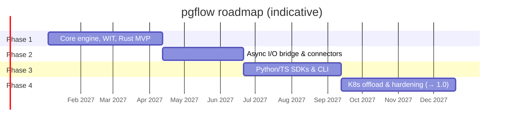

# 04 — Phased Implementation Roadmap

Four milestones from zero to production-ready. Durations assume a core team of **3–4 senior engineers** (Rust/Postgres-heavy, with one engineer owning Python/TS from Phase 3). They are planning estimates, not commitments.

**Cross-cutting from day 1:** CI matrix (PG 15–18 × x86_64/aarch64), the fault-injection harness, the conformance suite skeleton, and benchmark dashboards. Each phase adds to them; none of them waits for "hardening".

---

## Phase 0 — Spikes (2–3 weeks, inside the Phase 1 window)

Retire the scariest unknowns before committing to the design:

| Spike | Question | Kill/pivot criterion |
|---|---|---|
| S1 | Can Wasmtime (async + fibers + signal-based traps + pooling allocator) run stably inside a pgrx bgworker with Tokio on side threads? | Any unexplained crash under 24 h of soak → make tier T2 (supervised process, D8) the *only* DB-mode tier |
| S2 | Does deterministic replay of a componentize-py "hello workflow" work with virtualised `wasi:clocks`/`wasi:random`? | Per-instance memory or cold start far beyond NFR-2 → Python ships K8s-plane-first |
| S3 | Can `RegisterXactCallback` + shmem latch wake-ups be done safely from pgrx? | Fall back to polling + NOTIFY in DB mode |

---

## Phase 1 — Core engine, WIT contract & Rust MVP (≈14 weeks)

**Goal:** a Rust workflow with steps, SQL effects and durable timers runs inside Postgres, survives `kill -9` at any point, and replays deterministically.

### Deliverables

| Area | Deliverable |
|---|---|
| WIT | `pgflow:runtime@0.1.0`: `types`, `context`, `journal`, `effects` (`sql-query`, `sleep*`, `wait`; HTTP stubbed), `log`, `workflows` export |
| Schema | `pgflow-schema` migrations: modules, workflows, queues, runs, run_payloads, events (partitioned), DLQ, signals; `uuidv7()` for PG 15–17 |
| Extension | `pgflow-ext` (pgrx): GUCs, supervisor + dynamic executor bgworkers, main-thread reactor, `SpiBackend`, xact-callback wake-ups, lease sweeper |
| Engine | `pgflow-engine`: Wasmtime component host (`bindgen!`), virtualised WASI (clocks, random, cli, no FS/sockets), journal model, replay cursor + divergence detection, activation/evict model, fuel/epoch/memory limits, L1/L2 module caches with AOT at register time |
| SQL API | `register_module`, `activate`, `start` (transactional, idempotency key), `status`, `history`, `signal`, `cancel` |
| Rust SDK | `pgflow` guest crate: `#[workflow]`, `#[step]`, `ctx::{now, random, sql, sleep, wait_for_signal}`, single-threaded executor, `join!` |
| Tooling | Minimal `pgflow build` / `pgflow deploy` for Rust (cargo + wasm-opt + import validation) |
| Testing | Fault-injection harness (crash points behind a `failpoints` feature), replay property tests, PG 15–18 CI |

### Key risks

| Risk | Likelihood | Impact | Mitigation |
|---|---|---|---|
| Native crash in bgworker → cluster crash-restart | Med | **Critical** | Spike S1; T2 isolation tier designed in from the start (the `Backend` seam makes it cheap) |
| Thread-safety violation (PG call off main thread) | Med | Critical | All PG access behind `DbCommand`; pgrx thread checks; CI runs a debug-assert build of PG |
| Queue bloat/perf under churn | High | Med | Hot/cold split, fillfactor, autovacuum tuning, early pgbench-style load tests |
| WIT churn breaking SDKs | Med | Med | Contract freeze at end of phase; `0.1.x` additive only |

### Validation / exit criteria

- ✅ Example `order-saga` (5 steps, 2 SQL effects, 1 timer, 1 signal) completes on PG 15, 16, 17 and 18.
- ✅ **Fault injection:** 10,000 random `kill -9` (executor and postmaster) during runs → 0 lost runs, 0 duplicated SQL effects, all runs terminal.
- ✅ Determinism: a test guest that calls `SystemTime::now()`, `HashMap` iteration and `rand::random()` produces identical journals across 1,000 replays.
- ✅ Divergence detection: mutating the module between activations yields `nondeterminism` in the DLQ with the correct `seq`.
- ✅ Resource limits: infinite loop, memory bomb and deep recursion guests are each stopped and recorded **without** the bgworker restarting.
- ✅ Perf baseline: ≥ 1,000 steps/s on 8 vCPU (Rust, trivial steps); start→first-step p50 < 10 ms.

---

## Phase 2 — Async I/O bridge & connector runtime (≈10 weeks)

**Goal:** workflows safely call external APIs with exactly the guarantees promised: outbox-backed, idempotent, secret-safe, egress-controlled.

### Deliverables

| Area | Deliverable |
|---|---|
| Bridge | `pgflow-bridge`: Tokio runtime lifecycle inside the bgworker (post-fork init, graceful shutdown on SIGTERM), effect dispatch channel, hot-wait vs evict policy |
| HTTP | `http-fetch` with hyper + rustls: timeouts, response size cap, redirect policy, automatic `Idempotency-Key`, retry with backoff per step policy, journaled `wait_resolved` ordering for concurrent ops |
| Outbox | `outbox_requests` table, schedule-before-send protocol, recovery sweeper (expired `in_flight` → resend with same key), cleanup |
| Secrets | `{{secret:x}}` templating, `SecretProvider` trait with built-in (externally keyed), Supabase Vault and env/file providers; `secret_grants`; zeroize; redaction in journal and logs |
| Egress | Per-module allow-list from the manifest + admin overrides; SSRF guard (block RFC1918/link-local/metadata unless allowed; resolve-then-connect pinning against DNS rebinding) |
| Rate limits | Per-target token buckets (shared through a Postgres rate table, refilled by the supervisor) |
| Observability v0 | OTLP traces for activations, steps and effects from the bridge thread; `traceparent` passthrough |
| Plain-SQL mode (early) | `pgflow-worker --plane=local` against a schema-only install: proves D3 and powers T2 |
| SDK | Rust `http` client API; `join!`-based concurrent fetches |

### Key risks

| Risk | Likelihood | Impact | Mitigation |
|---|---|---|---|
| Tokio inside bgworker interferes with PG signals/latches | Med | High | Tokio threads block all signals (`pthread_sigmask`) so they are delivered to the main thread; eventfd wake-up; soak tests |
| Duplicate side effects with providers that ignore idempotency keys | High | Med | Clear `at_least_once` labelling, check-then-act helper, docs; per-effect `exactly_once_required` flag that refuses non-idempotent methods without a user key |
| Secret leakage through logs, errors or journaled requests | Med | Critical | Redaction at serialization boundary, property tests that scan all persisted rows and log output for canary secret values |
| Bridge memory growth (large responses) | Med | Med | Streaming with caps, offload large bodies to object store (P1) |

### Validation / exit criteria

- ✅ **Chaos test against a mock payment API** that honours idempotency keys: 10,000 runs with random crashes between schedule, send, receive and journal → 0 duplicate charges, 0 lost effects.
- ✅ Canary secret never appears in any table, WAL-decoded change stream, server log or OTLP export across the full test suite.
- ✅ SSRF suite (metadata IP, DNS rebinding, redirect to internal) blocked by default.
- ✅ 100 concurrent fetches inside one workflow (`join_all`) replay with identical completion order.
- ✅ Same example workflows pass in both DB mode (T1) and `pgflow-worker` against plain-SQL schema on a managed-PG-like setup (no extension).
- ✅ Hot-wait path: HTTP step overhead (excluding network) p50 < 2 ms.

---

## Phase 3 — Polyglot guest SDKs & CLI (Python & TypeScript) (≈12 weeks)

**Goal:** Python and TS developers get first-class, idiomatic SDKs with identical semantics, built and deployed with one command.

### Deliverables

| Area | Deliverable |
|---|---|
| Python SDK | `pgflow` package: `@workflow`, `@step`, `ctx`, `http`, custom `asyncio` loop (`PgflowLoop`), pydantic optional, type stubs; packaged with `componentize-py` + pre-init |
| TS SDK | `@pgflow/sdk`: `workflow()`, `step()`, `ctx`, `http`, deterministic job loop, generated types from WIT through `jco`; bundled with esbuild → `componentize-js` (StarlingMonkey) + pre-init |
| CLI | `pgflow init/build/deploy/run/inspect/history/retry/cancel/signal/replay`; language detection; hermetic toolchain cache (pinned `componentize-py`, `jco`, `wasm-tools`, `wasm-opt`); `--docker` build image; `manifest.json` with secrets, egress and limits |
| Size/cold-start | Stdlib trimming for Python; zstd at rest; AOT at deploy; `InstancePre` + pooling sized per language; benchmark suite and published table |
| Conformance | Language-neutral YAML scenarios (steps, retries, timers, signals, concurrency, cancellation, patching, nondeterminism detection), all passing for Rust, Python and TS |
| Testing kit | Per-language local test harness with time-skipping and an in-memory journal (FR-1.10) |
| Child workflows | Cross-language child start/await (`start-child`) |
| Scheduler | `pgflow.schedule()` built-in cron with exactly-once firing |
| Docs | Getting-started per language, determinism guide, connector guide, sizing guide |

### Key risks

| Risk | Likelihood | Impact | Mitigation |
|---|---|---|---|
| Python per-instance memory (tens of MB) limits concurrency inside the DB | High | High | Aggressive eviction + replay; per-language default queues; guidance to route Python-heavy fan-out to the K8s plane (Phase 4); track upstream work on smaller CPython builds |
| componentize-py/js lag behind WIT features (resources, async) or have breaking releases | Med | High | Pin versions; the WIT avoids exotic features (resources are used only for `step`, and the fallback is a `u64` handle); contribute upstream; keep a compatibility matrix in CI |
| Native Python deps unsupported | High | Med | Document "pure-Python only" for v1; build-time detection with a clear error; curated WASI wheel list later |
| Event-loop determinism subtleties (JS microtasks, asyncio callbacks, `call_soon` ordering) | Med | High | SDK owns the loop; conformance scenarios target interleavings; fuzz random gather/race trees and compare journals across 1,000 replays |
| Build-toolchain friction (Rust + Python + Node on dev machines) | Med | Med | Hermetic downloads + official build container; `pgflow doctor` |

### Validation / exit criteria

- ✅ Conformance suite: 100% pass for Rust, Python and TS on PG 15–18.
- ✅ Cold start (warm L1 cache): instantiate p50 Python < 10 ms, TS < 5 ms, Rust < 1 ms. Resident memory per idle instance published.
- ✅ `pgflow init --lang python && pgflow build && pgflow deploy && pgflow run` < 15 min for a new user (usability test with 5 external developers).
- ✅ Cross-language child workflow (TS parent → Python child → Rust grandchild) passes crash-injection tests.
- ✅ `pgflow replay` catches deliberately non-deterministic code changes in all three languages.
- ✅ Throughput published for each language (steps/s, memory per 1k concurrent sleeping vs. hot runs).

---

## Phase 4 — Hybrid K8s offloading & production hardening (≈14 weeks → v1.0)

**Goal:** the Day-100 story. The same modules run on an autoscaled K8s plane with per-queue routing and spillover, and the system meets the production NFRs.

### Deliverables

| Area | Deliverable |
|---|---|
| Worker | `pgflow-worker` GA: `TokioPostgresBackend`, connection pooling, `LISTEN` + jittered polling, module pull by sha256 + local AOT cache, graceful drain on SIGTERM (finish or evict within `terminationGracePeriodSeconds`), Prometheus `/metrics`, health probes |
| Isolation | Tier T2 (supervised process) productised for DB mode: bgworker supervises `pgflow-worker --plane=local` over a Unix socket |
| Routing | Queue `executor` policies (`local`/`remote`/`auto`), backpressure computation in the supervisor, hysteresis, `pgflow.remote_demand()`, `pgflow.backpressure()`; step-level `executor` hints (P2, stretch) |
| K8s | Helm chart, KEDA `ScaledObject` examples (scale-to-zero), init container for cache warm-up, CloudNativePG image with the extension, NetworkPolicy templates for egress |
| Versioning | Module GC, `migrate_runs` with automatic replay verification, patch markers across SDKs, WIT N/N-1 linkers |
| Observability | Full OTel semantic conventions for workflows; metrics catalogue; Grafana dashboards; SQL views (`run_timeline`, `queue_stats`, `failures`) |
| Ops | Retention/partition maintenance, archive moves, DLQ tooling (`dlq_requeue`), audit log, kill switch, upgrade scripts (`ALTER EXTENSION ... UPDATE`), backup/restore and failover runbooks |
| Security | Signed modules (`require_signed_modules`), per-tenant quotas + fair scheduling, RLS view templates, third-party security review of the extension and the host bindings |
| Perf | Batch claims and checkpoint coalescing, prepared statements, optional `durable_commit=false` queues, large-payload offload to object store |

### Key risks

| Risk | Likelihood | Impact | Mitigation |
|---|---|---|---|
| Spillover flapping / oscillation between planes | Med | Med | Hysteresis + cool-down, KEDA `cooldownPeriod`, simulation tests with synthetic load curves |
| Primary Postgres becomes the bottleneck (journal writes) even with remote compute | High | High | Batch event inserts, coalesced checkpoints, honest capacity docs, `continue_as_new` guidance; journal-on-separate-PG is a post-1.0 exploration |
| Connection storms from autoscaled workers | Med | High | Small per-pod pools; PgBouncer (transaction mode) compatibility: no session state, so `LISTEN` uses a dedicated direct connection or falls back to polling |
| Version skew between DB-mode engine and remote workers | Med | Med | Workers advertise engine + WIT versions in `pgflow.workers`; claims filter on compatible `wit_version`; rolling-upgrade runbook |
| Security review findings late in schedule | Med | High | Start the review at Phase 4 week 4, not at the end; fuzzing continuous since Phase 1 |

### Validation / exit criteria (v1.0 gate)

- ✅ **Spillover demo:** a load spike of 50× baseline on an `auto` queue. Local plane stays under its CPU threshold, KEDA scales workers 0 → N, the backlog drains, workers scale back to 0, and no run is lost or duplicated.
- ✅ **Plane portability:** the same module sha executes a run that alternates local → remote → local (forced through hints) with an identical journal compared to a local-only run.
- ✅ **Failover:** Patroni/CNPG primary failover during load → all runs complete after promotion; no duplicate SQL effects.
- ✅ **Soak:** 7-day soak at 70% of rated throughput with zero bgworker crashes, stable memory, and bounded table/index bloat (< 30%).
- ✅ Rolling upgrade from the previous minor without draining in-flight runs.
- ✅ OTel traces show the complete run across activations and planes in Jaeger/Tempo.
- ✅ External security review: no open critical/high findings.
- ✅ All NFR targets in [02-prd §3](02-prd.md#3-non-functional-requirements) measured and published.

---

## Post-1.0 backlog (candidates)

- WASI 0.3 native async (`pgflow:runtime@0.2.0`) once the toolchains are stable across all three languages.
- Polyglot connector components (Stripe, Slack, S3) composed at build time; connector registry.
- Web UI (run explorer, DLQ triage, replay debugger with time travel).
- More guest languages: Go (TinyGo / upstream wasip2), C#, and anything else that emits components.
- Journal storage offload (cold events to object storage; separate journal database).
- Query handlers and updates (synchronous request/response into running workflows).
- `pg_tle`-style trusted install path discussions with managed-PG vendors for DB mode.

## Risk register summary (top 5 across the program)

| # | Risk | Owner phase | Status trigger |
|---|---|---|---|
| R1 | Native crash inside bgworker takes down the cluster | P1 (S1) → P4 (T2 GA) | Any crash in soak → T2 becomes default |
| R2 | DB-mode unavailable on managed Postgres limits adoption | P2 (plain-SQL mode) | Track the install-mode split in opt-in telemetry |
| R3 | Python/JS runtime size and memory make in-DB polyglot impractical | P0 (S2) → P3 | Miss NFR-2 targets → K8s-first for Python |
| R4 | Component Model / componentize toolchain churn | P3 | Upstream breaking release → pin + patch |
| R5 | Single-primary write throughput ceiling | P4 | Benchmarks below target → batching work + docs |
